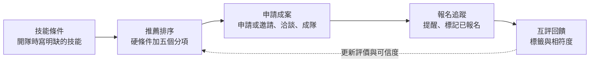

# Fomo鬆 產品規格書 3.1（草案）

2026-11-23 · Jack Peng

**實作現況（2026-11-23 晚）**：主線七步的後端與網頁已經完成並通過測試；帳號精簡（M2）、排序新定義與權重調整器進管理頁（M5）、iOS（M8）還沒做。細節與測試結果見《[實作紀錄 M0–M4](實作紀錄-M0-M4.md)》。

**更新（2026-11-23 晚）**：D72、D80、D83 依你的回覆照預設定案；工程設計已寫成《軟體工程架構 3.1》，取代 README 3.0 草案。

3.1 只做比賽，主線七步：選比賽 → 開隊 → 推薦／找隊 → 申請／邀請 → 洽談 → 成隊 → 報名追蹤。這一版另外保留管理端的媒合成效分析、把排序權重的依據與調整器寫進規格、保留 AI 成長建議 Prompt。這份文件只是規格，程式尚未修改。

**標示**：【一手】讀現有程式、2.0 規格書、同學版或法規原文確認；【一手：實跑】2026-11-23 在本機執行 2.0 的示範資料得到的數字；【二手】轉述的題目文字與 ChatGPT 對話；【推論】設計判斷。

## 目錄

1. 結論
2. 題目要求對照
3. 定位、使用者與情境
4. 範圍
5. 流程閉環
6. 主線步驟與狀態
7. 功能需求
8. 推薦排序與權重
9. 即時通訊
10. AI 成長建議 Prompt
11. 畫面與導覽
12. 權限與個資
13. 資料分析
14. 非功能需求與測試
15. 驗收與 Demo
16. 決策
17. 待確認事項
18. 對工程文件的影響
19. 來源

## 與 3.0 草案的差異

| # | 你的指示 | 3.0 草案 | 3.1 |
|---|---|---|---|
| 1 | 只做比賽，主線七步 | 競賽、專題、短期支援三種類型 | 只有比賽；專題、短期支援、研究協作停用（D61、D62 已定） |
| 2 | 保留管理端的媒合成效分析 | 5 支現有 API 加 4 個新指標 | 本版用現有 5 支 API；4 個新指標改為選做（D74 已定）。實跑後發現「推薦品質」這一支要小改，見第 13 節 |
| 3 | 權重怎麼定、合不合理、寫一個權重調整器 | 只列出公式與權重 | 新增第 8.4 至 8.7 節與 FR-26；調整器已做成可操作的原型（D82、D83） |
| 4 | AI 成長建議 Prompt | 停用 | 保留，移到個人頁（第 10 節、FR-27、D84 已定） |

## 1 結論

**只做比賽後，題目 11 項要求中 10 項仍然成立，第 2 項由「符合」變成「部分符合」。** 這是範圍取捨，不是缺功能，口試時要主動說明（第 2 節有說法）【推論】。

| # | 重點 | 內容 | 層級 |
|---|---|---|---|
| 1 | 主線 | 七步都對得上題目的驗收閉環「技能條件 → 推薦排序 → 申請成案」，再加報名追蹤與互評回饋 | 推論 |
| 2 | 資料分析 | 現有 5 支分析 API 中 4 支可直接用；「推薦品質」能呼叫，但隊長再開一次推薦名單，數字就歸零，要改快照的保存方式 | 一手：實跑 |
| 3 | 權重的來源 | 0.40／0.20／0.20／0.10／0.10 是 2.0 的決策 D37，文件只記了數值，沒有推導、問卷或資料估計 | 一手 |
| 4 | 權重合不合理 | 當起始值可以：方向對，每項加減 5 個百分點時第 1 名有 92.3% 不變。但有兩個問題：時間的 20% 在示範資料裡完全不影響名次，只有可用期間不足的人才會被扣分；上線初期沒有互評與回應紀錄，幾乎只剩技能與跨系在排序，在示範資料上接近各半 | 一手：實跑；示範資料 |
| 5 | 權重調整器 | 已做成可操作的原型；正式版放管理端，加上儲存、變更紀錄與回放 | 本次產出 |
| 6 | AI 成長建議 Prompt | 現有功能保留，移到個人頁；平台不替使用者送出 | 一手 |

**怎麼讀**：第 2 節是逐條對照；第 5 至 11 節是產品怎麼運作；第 8 節回答權重的三個問題；第 16 節是決策；第 17 節是要決定的事。

## 2 題目要求對照

題目文字共 11 項要求【二手：轉述的題目文字】。3.1 直接符合 6 項、補強或保留後符合 3 項、部分符合 1 項、Demo 準備 1 項。

| # | 題目要求 | 3.1 的對應 | 判定 | 現有程式【一手】 |
|---|---|---|---|---|
| 1 | 把分散的人才與合作需求，變成校園內可流動的資源 | 隊伍牆、比賽頁、找隊中名單都跨系可見；排序含「跨系互補」分項 | 符合 | 排序引擎已有跨系分項 |
| 2 | 找專題隊友、競賽夥伴、特定技能支援 | 競賽夥伴是主線；特定技能支援以「隊伍缺的技能」與「以技能找人」涵蓋，情境限於比賽；專題隊友不在這一版 | 部分符合 | 資料表仍有四種類型，2.0 已實作同一套規則 |
| 3 | 需求發布 | 開隊，4 欄 | 符合 | 已有，表單要精簡 |
| 4 | 技能搜尋 | 以技能搜尋隊伍；以技能搜尋開放被邀請的同學 | 補強後符合 | 隊伍搜尋已有；找人搜尋要新做 |
| 5 | 推薦媒合；驗收「技能條件 → 推薦排序 → 申請成案」 | 技能條件必填；雙向排序；申請或邀請 → 洽談 → 接受 | 補強後符合 | 硬條件、計分、狀態機已有 |
| 6 | 成案管理與成案追蹤 | 成隊後的報名追蹤：提醒、標記已報名、鎖定名單 | 符合 | 成隊已有；報名追蹤要新做 |
| 7 | 不是做留言板 | 沒有公開留言；對話只掛在申請或隊伍；每支隊伍都有結構化的技能條件 | 符合，要守住 | 現在沒有聊天功能 |
| 8 | 全端系統、資料庫設計、核心流程 | Spring Boot、PostgreSQL、Vue、iOS | 符合 | 已有，45 張資料表、104 個 API |
| 9 | 資料分析 | 管理端「媒合成效」；權重調整器的實際影響力與穩定度分析 | 保留後符合 | 5 支分析 API 已有 |
| 10 | 平台涵蓋前端、後端、資料分析、簡報設計 | 技能表 9 類 57 項，含前端、後端、資料分析、簡報四類 | 符合 | 已有 |
| 11 | Demo 口試 | 第 15 節的劇本與追問對照 | 待準備 | — |

**題目舉的三則合作需求**：技能需求都保留，情境改成比賽，三則都列入 Demo。

| 題目的範例 | 3.1 怎麼呈現 | 技能條件 | 和題目的差異 |
|---|---|---|---|
| 創業競賽需要網站 Demo | 創業競賽的隊伍缺會做網站 Demo 的人 | 網頁開發、UI/UX 設計 | 無 |
| 專題缺資料視覺化夥伴 | 比賽隊伍缺資料視覺化的人 | 資料視覺化 | 情境由專題改為比賽 |
| 短期需要 UI/UX 設計支援 | 比賽隊伍缺 UI/UX 設計的人 | UI/UX 設計 | 情境由短期支援改為比賽 |

**第 2 項的口試說法**【推論】：這一版把範圍定在比賽，把閉環做完整。專題與短期支援用的是同一套資料結構與規則，2.0 已經實作過四種類型，資料表沒有刪，之後開放不用改資料結構。

## 3 定位、使用者與情境

Fomo鬆 讓逢甲學生跨系組隊參加比賽：隊長選比賽、開隊並寫明缺什麼技能，系統雙向推薦，申請或邀請後直接對話，成隊後追蹤到完成報名。

| 使用者 | 想做的事 | 在產品裡做什麼 |
|---|---|---|
| 隊長 | 找到補得上缺口的隊友 | 選比賽、開隊、設技能條件、看推薦隊友、邀請、接受申請、標記已報名 |
| 找隊的學生 | 找到用得上自己能力的隊伍 | 看「適合我」的隊伍、以比賽或技能搜尋、申請、洽談；或開放被邀請 |
| 管理員 | 維護資料、看平台有沒有用 | 維護比賽與技能表、審核學生貼的比賽、處理檢舉、看媒合成效、調整排序權重 |

學生包含學士、碩士、博士生（沿用 D11）。教師不是平台使用者（沿用 D60）。

**要解決的問題**

| 題目描述的現況【二手】 | 3.1 的做法 |
|---|---|
| 靠 Dcard 發文、社群詢問：看到的人不一定有需要的技能 | 開隊時寫明技能條件，系統把隊伍排給有這些技能的人，也把人選排給隊長 |
| 同班湊合：技能重疊，缺跨系的能力 | 排序把跨系互補算進去；找隊中名單跨系可見 |
| 談到一半沒下文，不知道成不成 | 申請有狀態與回應期限；成隊後有報名追蹤 |

## 4 範圍

這一版只保留主線用得到的功能。停用的功能從畫面移除，程式與資料表先保留。

| 處理 | 項目 | 說明 |
|---|---|---|
| 做 | 比賽清單與比賽頁 | 現有 28 筆；清單沒有的，學生可貼官方連結開隊，管理員審核後進清單 |
| 做 | 開隊 | 4 欄；技能條件至少 1 項 |
| 做 | 找隊 | 隊伍牆、以比賽或技能搜尋、「適合我」排序 |
| 做 | 找人 | 推薦隊友、找隊中名單、以技能找人（只含開放被邀請者） |
| 做 | 申請與邀請 | 同一個流程與名額；回應期限 72 小時（沿用 D17、D20） |
| 做 | 即時通訊 | 洽談對話、隊伍群組（第 9 節） |
| 做 | 成隊與報名追蹤 | 提醒、標記已報名、鎖定名單 |
| 做 | 比賽結束後互評 | 標籤加一題相符度；結果回到排序 |
| 做 | 管理端 | 比賽、技能表、檢舉、媒合成效分析、排序權重調整器 |
| 做 | AI 成長建議 Prompt | 放在個人頁；系統組出 Prompt，使用者預覽、刪改後自己貼到選定的 AI（第 10 節） |
| 精簡後保留 | 成績、證照、得獎 | 改成個人頁的選填佐證，不在註冊流程 |
| 精簡後保留 | AI 助理 | 收成浮動入口；排序仍由規則計算 |
| 精簡後保留 | 指導老師推薦 | 只在比賽規定需要指導老師時出現 |
| 停用 | 專題、短期支援、研究協作三種類型 | 畫面與 API 不再建立；資料表的類型欄位與舊資料保留（D12、D13、D18） |
| 停用 | 成長儀表板、知識圖譜、Obsidian 匯出 | D30 的畫面、D51、D52 |
| 停用 | 結案投票 | 改為比賽結束日後自動結束（D34） |
| 不做 | 同學版的找活動、組個局 | 不在主線上；這一版不放（D80） |
| 不做 | 平台內代為報名比賽 | 報名在主辦單位的網站完成 |
| 不做 | 公開留言、任意私訊 | 對話只掛在申請或隊伍 |
| 不做 | 付款、獎金分配、代為聯絡老師 | 沿用 D15、D60 |

## 5 流程閉環

前三格是題目的驗收重點。互評回饋會更新評價與可信度，回到下一次排序（沿用 D6）。即時通訊只掛在申請成案與報名追蹤這兩格，所以不是留言板。

| 驗收閉環 | 主線步驟 |
|---|---|
| 技能條件 | 1 選比賽、2 開隊 |
| 推薦排序 | 3 推薦／找隊 |
| 申請成案 | 4 申請／邀請、5 洽談、6 成隊 |
| 成案追蹤 | 7 報名追蹤 |
| 評價回饋 | 主線之後的互評 |

## 6 主線步驟與狀態

主線七步，每一步都留下資料與狀態，不靠留言。

| # | 步驟 | 隊長 | 找隊的人 | 系統 | 狀態 |
|---|---|---|---|---|---|
| 1 | 選比賽 | 在比賽清單挑一場，或貼官方連結新增 | 同左；可按「我想參加，還沒有隊」 | 顯示截止日、人數上下限、需要的技能、是否需要指導老師、官方連結 | — |
| 2 | 開隊 | 填隊名、還缺幾人、想找的技能、一句話介紹 | — | 建立隊伍與隊伍群組；技能條件進入排序 | 隊伍：招募中 |
| 3 | 推薦／找隊 | 看推薦隊友、找隊中名單、以技能找人 | 看「適合我」的隊伍、以比賽或技能搜尋 | 先過硬條件，再計分排序，附理由 | — |
| 4 | 申請／邀請 | 對人選按邀請，寫一句話 | 對隊伍按申請，寫一句話 | 開一則洽談對話、通知對方、開始計算回應期限 | 申請：待回覆 |
| 5 | 洽談 | 在對話裡談；收到申請的一方按接受或婉拒 | 同左；送出的一方可以取消 | 新訊息即時送達；逾時自動結束並釋放名額 | 申請：已接受、已婉拒、已取消、逾時 |
| 6 | 成隊 | 名額到齊自動成隊，或提前按「成隊」 | 被接受後自動加入隊伍群組 | 停止招募、通知全隊 | 隊伍：已成隊 |
| 7 | 報名追蹤 | 到官方網站報名後標記已報名 | 在群組看剩餘天數與檢核項 | 截止前 7、3、1 天提醒全隊；標記後鎖定名單 | 隊伍：已報名 |
| 之後 | 互評回饋 | 比賽結束後互選標籤、回答一題相符度 | 同左 | 更新評價與可信度，下一次排序用得到 | 隊伍：已結束 |

**隊伍狀態與現有程式的對應**【一手：現有狀態值】

| 畫面上的狀態 | 現有狀態值 | 怎麼進入 | 要不要改程式 |
|---|---|---|---|
| 招募中 | OPEN | 開隊 | 不用 |
| 已成隊 | FORMED | 名額到齊，或隊長按「成隊」 | 提前成隊要新做 |
| 已報名 | IN_PROGRESS 加報名日期 | 隊長標記已報名 | 報名日期欄位要新增 |
| 已結束 | CLOSED | 比賽結束日後自動結束 | 取代原本的結案投票 |
| 已取消、已過期 | CANCELLED、EXPIRED | 隊長取消；報名截止仍未成隊 | 不用 |

**規則**

1. 同一場比賽，一個人只能在一隊（新增）。
2. 報名前隊員可退出、隊長可請人離開；標記已報名後名單鎖定（新增）。
3. 回應期限為 72 小時或報名截止日，取較早者；到期前 24 小時提醒，逾時釋放名額（沿用 D20、D21、D24）。
4. 每人同時開放的隊伍數上限由管理員設定（沿用 D23）。
5. 比賽允許一人參賽時，隊長可以一個人成隊（新增）。

## 7 功能需求

共 27 項：現有程式已經有的 7 項、要改的 12 項、要新做的 8 項。「現況」欄是讀現有程式確認的【一手】。

| 編號 | 需求 | 驗收條件 | 現況 |
|---|---|---|---|
| FR-01 | 註冊與登入：學校信箱、5 欄加同意 | 信箱未驗證時不能申請、邀請、傳訊，畫面說明原因 | 要改：現為 10 欄加 2 個同意，沒有信箱驗證 |
| FR-02 | 個人頁：技能自評（三階）、一句佐證、合作偏好；成績、證照、得獎選填 | 只填技能自評就能申請與被推薦 | 要改：功能已有，流程要精簡 |
| FR-03 | 開放被邀請：註冊時必選「開放」或「先不要」，之後可改 | 選「先不要」的人不出現在找隊中名單、以技能找人、推薦隊友 | 新做 |
| FR-04 | 比賽清單與比賽頁 | 顯示截止日、剩餘天數、每隊人數、是否需指導老師、需要的技能、官方連結、查證日；過期比賽不能開隊 | 已有，版面重做 |
| FR-05 | 學生貼官方連結新增比賽 | 填名稱、連結、截止日就能開隊；管理員審核前不出現在公開清單 | 要改：審核欄位已有，學生提交要新做 |
| FR-06 | 開隊 | 4 欄：隊名、還缺幾人、想找的技能（至少 1 項、從技能表選）、一句話（選填）；截止日與人數上限由比賽帶入 | 要改：現為 8 欄加每個角色 4 欄 |
| FR-07 | 隊伍牆與搜尋 | 可用比賽、技能篩選；「適合我」依排序分數由高到低 | 已有：推薦給我的隊伍 API；版面重做 |
| FR-08 | 推薦隊友 | 每隊可看排序後的人選、理由、未過的硬條件；只含開放被邀請者 | 要改：排序已有，名單範圍要改 |
| FR-09 | 以技能找人 | 輸入技能，列出開放被邀請且具備該技能的同學，顯示系級、技能階級、合作標籤 | 新做 |
| FR-10 | 申請與邀請 | 同一隊同時只能有一筆待回覆；可取消；逾時自動結束並釋放名額 | 已有 |
| FR-11 | 洽談對話 | 申請或邀請送出時自動建立；雙方不用重新整理就看到新訊息；上方依身分只顯示接受、婉拒或取消 | 新做 |
| FR-12 | 隊伍群組 | 開隊時建立；接受後自動加入；退出或被請離後看不到之後的訊息 | 新做 |
| FR-13 | 成隊 | 名額到齊自動成隊；隊長可提前成隊 | 要改：自動成隊已有，提前成隊新做 |
| FR-14 | 報名追蹤 | 群組上方顯示剩餘天數、檢核項、官方連結；隊長標記已報名後全隊收到通知、名單鎖定 | 新做 |
| FR-15 | 結束 | 比賽結束日後自動結束並開放互評；不需要成員投票 | 要改：取代結案投票 |
| FR-16 | 人員異動 | 報名前成員可退出、隊長可請離；同一場比賽一人只能在一隊 | 新做 |
| FR-17 | 互評 | 結束後 72 小時內，對每位隊友選最多 3 個標籤並回答相符度（1–5）；雙方都送出才公開 | 要改：現為四項 1–5 分 |
| FR-18 | 通知 | 申請、回覆、成隊、提醒、新訊息都有站內通知與未讀數 | 要改：通知已有，要加訊息類 |
| FR-19 | 檢舉與封鎖 | 任一則訊息可檢舉；封鎖後對方不能再對你申請、邀請、傳訊 | 新做 |
| FR-20 | 指導老師推薦 | 比賽規定要指導老師時，隊伍群組顯示推薦名單與待確認條件 | 已有 |
| FR-21 | AI 助理 | 浮動入口；建立隊伍與送邀請前要使用者確認；未同意或沒有金鑰時改用規則模式 | 已有，入口要改 |
| FR-22 | 管理：比賽與技能表 | 新增、修改、審核；每筆比賽保留來源與查證日 | 已有 |
| FR-23 | 管理：媒合成效 | 第 13 節的 5 個指標都查得到 | 已有；其中推薦品質要改快照的保存方式，併入 FR-26 |
| FR-24 | 管理：檢舉處理 | 管理員只看得到被檢舉的訊息；可停權 | 新做 |
| FR-25 | 帳號刪除與資料保存 | 沿用 D26 至 D28；聊天訊息依第 12 節的期限處理 | 要改：刪除已有，聊天部分新做 |
| FR-26 | 管理：排序權重調整器 | 總和固定 100%；儲存前看得到新舊名次與實際影響力；儲存必填原因並留下紀錄；伺服器檢查範圍（第 8.7 節） | 要改：現為五個數字欄位，只檢查總和 |
| FR-27 | AI 成長建議 Prompt | 目標與問題未填不能產生；可刪改後複製；不含隊友姓名、評語原文、隊伍名稱、對話內容；平台不呼叫外部 AI（第 10 節） | 要改：API 與畫面已有，移到個人頁、用語改為隊伍 |

## 8 推薦排序與權重

排序沿用現有引擎：先過硬條件，再用五個分項計分。規則計算，同樣的資料得到同樣的結果（沿用 D37、D38、D41）。排序是雙向的：隊長看推薦隊友，學生看「適合我」的隊伍，用同一組硬條件與公式【一手】。

### 8.1 技能條件

1. 每支隊伍至少 1 項技能，從技能表選（9 類 57 項），不能自由輸入。
2. 每項技能可勾「一定要會」。勾了才是硬條件；沒勾只影響排序。
3. 可選最低等級，預設不限。等級三階：初階、中階、進階（沿用 D53）。
4. 開隊時預先帶入「比賽需要、而隊長還沒有」的技能，隊長可以改。

### 8.2 硬條件

沒過就不推薦，並說明原因。前四項是現有的【一手】，後兩項是新增。

| 硬條件 | 內容 |
|---|---|
| 身分 | 不是隊長本人、不在隊內、沒有待回覆的申請或邀請 |
| 必要技能 | 每項「一定要會」的技能都達到要求的等級 |
| 時間 | 每週可投入時數不低於需求時數，且可用期間與比賽期間有重疊 |
| 名額 | 隊伍招募中且還有名額 |
| 開放被邀請（新增） | 推薦隊友與以技能找人，只列開放被邀請的同學 |
| 同一場比賽（新增） | 已經在同一場比賽其他隊的人不列入 |

### 8.3 計分

分數 = 100 ×（0.40 技能 + 0.20 時間 + 0.20 評價 + 0.10 回應率 + 0.10 跨系）【一手：現有公式與權重】

| 分項 | 權重 | 怎麼算（每項 0 到 1） | 沒有紀錄時 |
|---|---|---|---|
| 技能符合度 S | 0.40 | 必要技能權重 2、其他 1；達到要求等級的技能以「技能分數 ÷ 100」計；加權平均後乘可信度係數 | 缺必要技能就被硬條件擋下 |
| 時間配合 T | 0.20 | min(可投入時數 ÷ 需求時數, 1) × 期間重疊比例 | — |
| 評價 R | 0.20 | 0.75 × 隊友互評 + 0.25 × 得獎 | 互評以 0.5 計；沒有得獎時 R = 0.375 |
| 回應率 P | 0.10 | 有回應的次數 ÷ 應回應的次數 | 1.0 |
| 跨系互補 C | 0.10 | 和隊長比：跨學院 1.0、同學院不同系 0.5、同系 0 | — |

同分時，進行中隊伍較少的人排前面。權重存在資料表 `ranking_weights`，管理後台可改，改了立即生效【一手】。

### 8.4 權重是怎麼定的

**這組權重是設計時的判斷值，不是從資料算出來的。**

| 問題 | 答案 | 層級 |
|---|---|---|
| 數值從哪來 | 2.0 規格書的決策 D37：「技能 0.40、時間 0.20、評價 0.20、回應率 0.10、跨系 0.10」。程式的預設值、資料表的初始值、README 都是這組數字 | 一手 |
| 有沒有推導或資料 | 沒有。D37 只有數值；2.0 規格書的排序章節只說明每個分項怎麼算，沒有記錄權重的推導、問卷或資料估計 | 一手 |
| 當時對權重的要求 | 「權重、係數、矩陣都存在資料表，口試時可現場調整並重排」，也就是全站一組、管理員可調 | 一手 |
| 數值背後的邏輯 | 可以還原成一組比例判斷 4：2：2：1：1。技能是題目的驗收重點，放最高；時間與評價回答「能不能做、做得好不好」，各是技能的一半；回應率與跨系是輔助，各是技能的四分之一 | 推論 |

### 8.5 權重合不合理

**當起始值可以，但設定的權重和實際影響力不一致（下表第 3、4 項），另有三件事要決定或補上（第 5 至 7 項）。**

數字來自 2.0 的示範資料：50 位虛構學生、10 個招募中的缺口、121 筆通過硬條件的人選，2026-11-23 用 2.0 的排序引擎實際算出【一手：實跑】。示範資料是我為 Demo 編的，真實學生的分布要上線後才知道；下面凡是百分比都只說明「權重怎麼作用」，不代表真實情況。

| # | 檢查 | 結果 | 判定 | 層級 |
|---|---|---|---|---|
| 1 | 和題目一致嗎 | 技能權重最高，對得上「技能條件 → 推薦排序」；跨系有獨立分項 | 合理 | 推論 |
| 2 | 數字需要很精準嗎 | 每個權重隨機加減 5 個百分點 2,000 次：第 1 名不變 92.3%、前 3 名重疊 95.6%。加減 10 個百分點：84.9%、89.5% | 合理：不必精調 | 一手：實跑 |
| 3 | 時間分項有作用嗎 | 121 筆人選的時間分數全部是 1.00。時數不足的人已被硬條件擋掉，超過需求的時數不加分；只有可用期間沒有涵蓋整個比賽期間的人會低於 1（註冊時預設可用期間是註冊日起 6 個月）。把時間的權重拿掉、其餘等比例放大，10 份名單的順序完全不變 | 不合理：20% 的權重幾乎不影響名次 | 一手：程式與實跑 |
| 4 | 上線初期呢 | 沒有互評時，評價只剩得獎在作用，沒填得獎的人固定 0.375；沒有回應紀錄時，回應率固定 1.0。把示範資料改成剛上線的狀態：得獎仍計時，技能 41.6%、評價 20.8%、跨系 37.6%；沒人填得獎時，技能 52.5%、跨系 47.5% | 要留意：初期接近技能與跨系各半 | 一手：程式；示範資料 |
| 5 | 跨系的份量 | 跨學院比同系多 10 分，等於單一技能需求下 25 分的技能分數（中階下限 70 分和 95 分的差距），也高於「互評滿分」對「沒有互評」的 7.5 分 | 待決定：是不是要這麼強 | 一手：公式換算 |
| 6 | 跨系和誰比 | 只和隊長比，不看隊上其他成員。隊長是資工系、隊上已有一位企管系時，再來一位企管系仍然拿滿分 | 可改進 | 一手：程式 |
| 7 | 有制定依據嗎 | 沒有紀錄（第 8.4 節） | 要補 | 一手 |

**每個差異值多少分**（現行權重；單一必要技能的缺口）【一手：公式換算】

| 兩位人選的差異 | 分數差 | 相當於技能分數差 |
|---|---|---|
| 技能分數 95 對 70 | 10.0 | 25 |
| 跨學院對同系 | 10.0 | 25 |
| 同學院不同系對同系 | 5.0 | 12.5 |
| 互評平均 5 星對沒有互評 | 7.5 | 18.75 |
| 互評平均每差 1 星 | 3.0 | 7.5 |
| 全國第一名的得獎對沒有得獎 | 4.0 | 10 |
| 回應率 100% 對 50% | 5.0 | 12.5 |
| 可信度係數 1.0 對 0.8（技能分數 85） | 6.8 | 17 |
| 每週可投入時數比需求多 | 0 | 0 |

**設定的權重和實際影響力**【一手：實跑；示範資料】

實際影響力 = 權重 × 該分項在同一份名單內的標準差，再換算成百分比。分項在名單裡每個人都一樣時，權重再高也不影響名次。

| 分項 | 設定的權重 | 已有合作紀錄 | 剛上線（得獎仍計） | 剛上線且沒人填得獎 |
|---|---|---|---|---|
| 技能 | 40% | 35.5% | 41.6% | 52.5% |
| 時間 | 20% | 0% | 0% | 0% |
| 評價 | 20% | 23.0% | 20.8% | 0% |
| 回應率 | 10% | 17.3% | 0% | 0% |
| 跨系 | 10% | 24.3% | 37.6% | 47.5% |

**換一組權重，名單會差多少**【一手：實跑；示範資料，10 份名單】

| 候選權重（技能／時間／評價／回應率／跨系） | 第 1 名相同 | 前 3 名重疊 | 名次有變的人選 |
|---|---|---|---|
| 等權 20／20／20／20／20 | 10 份中 7 份 | 86.7% | 121 筆中 77 筆 |
| 技能優先 60／10／10／10／10 | 10 份中 7 份 | 80.0% | 121 筆中 84 筆 |
| 跨系加倍 30／20／20／10／20 | 10 份中 8 份 | 90.0% | 121 筆中 60 筆 |
| 不計跨系 45／20／25／10／0 | 10 份中 7 份 | 83.3% | 121 筆中 70 筆 |
| 不計時間 50／0／25／12.5／12.5 | 10 份中 10 份 | 100% | 121 筆中 0 筆 |

另一個觀察：10 份名單中有 6 份，總分第 1 名不是技能分數最高的人，差別來自評價、回應率與跨系。這是設計本意，口試時可以舉例【一手：實跑】。

### 8.6 這一版怎麼處理

| # | 處理 | 內容 | 狀態 |
|---|---|---|---|
| 1 | 預設值不動 | 維持 0.40／0.20／0.20／0.10／0.10。理由：小幅調整幾乎不改變結果；沒有真實資料前，改數字沒有依據 | D82 草案 |
| 2 | 補上制定依據 | 把 4：2：2：1：1 的比例判斷寫進文件。選做：請 5 至 10 位同學用調整器的「兩兩比較」各填一次，取幾何平均，留下權重與一致性比率（CR 不超過 0.10 才採用） | D82 草案 |
| 3 | 時間分項改定義 | 時間 = min(可用時數 ÷ 需求時數, 1)，可用時數 = 每週可投入時數 − 其他進行中隊伍的需求時數合計（最低 0）。硬條件不變。同時在別隊的人，時間分數會比較低 | D83 已定 |
| 4 | 跨系分項改定義 | 改成和整隊比：人選的學院隊上還沒有 → 1.0；學院有、系所還沒有 → 0.5；系所已經有 → 0。隊上只有隊長時，結果和現在相同 | D83 已定 |
| 5 | 護欄 | 技能不低於 30%；單一分項不高於 60%；總和 100%。伺服器端也檢查（現在只檢查總和【一手】） | D82 草案 |
| 6 | 變更要留紀錄 | 每次儲存必填原因，寫入操作紀錄：誰、何時、舊值、新值、原因 | D82 草案 |
| 7 | 檢討時機 | 累積 30 筆「被接受的申請或邀請」後，用調整器的回放比較現行與候選權重；之後每學期一次。30 是我建議的門檻 | D82 草案；推論 |

第 3、4 項改完之前，時間的 20% 幾乎不起作用，實際上接近其餘四項以 50／25／12.5／12.5 在排序。

### 8.7 權重調整器（管理端，FR-26）

原型：[Fomo鬆 推薦權重調整器](https://claude.ai/artifact/VpXL61LBiZxpLjia2CKUs8)。原型用示範資料，不連系統，不能儲存。

| 項目 | 規格 | 原型 |
|---|---|---|
| 位置與權限 | 管理端；只有管理員 | — |
| 調整 | 五個分項 0 至 100%、每次 1%；總和固定 100%：拖一項，其餘沒鎖定的依原比例跟著調；可鎖定個別分項；可直接輸入數字 | 有 |
| 預設組合 | 現行、等權、技能優先、跨系減半 | 有 |
| 名次預覽 | 選一支招募中的隊伍，新舊名次並列：第 1 名有沒有換人、前 3 名重疊幾位、名次有變的人數、每個人的分數組成 | 有（4 份示範名單） |
| 實際影響力 | 設定的權重和實際影響力並列；分項沒有差距時用文字說明 | 有 |
| 資料情境 | 目前資料、剛上線（沒有互評與回應紀錄） | 有 |
| 兩兩比較 | 10 組「誰比誰重要、重要幾倍」→ 權重與一致性比率 CR；可套用 | 有 |
| 護欄 | 技能低於 30%、單一分項高於 60% 時提示；伺服器拒絕超出範圍的值 | 只有提示 |
| 回放 | 用保存的推薦名單重算：被接受的人在候選權重下排第幾（平均名次、前 3 名比例） | 沒有：要先改快照的保存方式（第 13 節） |
| 儲存 | 必填原因；寫入操作紀錄；可還原預設值 | 沒有：只輸出設定值 |

**和附件版 `fomo_weight_adjuster.html` 的差別**【一手：讀附件原始碼並實測】

| 項目 | 附件版 | 新版 |
|---|---|---|
| 拖動時 | 每次都把五項一起重新正規化：把技能拖到 0.60，放開後變成 0.50 | 拖到 60% 就停在 60%，其餘依原比例分攤 |
| 總和 | 各項顯示值四捨五入：把時間拖到 0 時顯示 0.50／0.00／0.25／0.13／0.13，相加是 1.01 | 整數百分比，總和固定 100% |
| 看效果的方式 | 一位候選人的五個分數，算出一個總分 | 整份名單的名次前後比較 |
| 硬條件、實際影響力、情境、鎖定、兩兩比較 | 沒有 | 有 |
| 輸出 | 自訂的鍵名（skill、time、eval、resp、cross） | 系統的鍵名（S、T、R、P、C），可直接用在後台 API 與資料表 |
| 複製成功的提示 | 跳出視窗 | 頁面內文字 |
| 橘底按鈕的文字 | 白字，對比 2.95：1 | 深色字，對比 5.39：1 |

### 8.8 這一版對輸入的調整【推論】

1. 互評改成標籤後，評價分項裡的「隊友互評」改用「平均每則互評收到的標籤數 ÷ 3」；得獎的比重不變。
2. 相符度只用來調整可信度係數（沿用 D9、D38）。
3. 開隊不再填每週時數，時間分項用系統預設的需求時數；每週可投入時數放在個人頁的合作偏好。

### 8.9 畫面怎麼顯示

1. 卡片只顯示白話理由，例如「補上你們缺的深度學習」「你會其中 2 項」「跨學院」，不顯示分數。
2. 每筆推薦可展開「為什麼推薦」：五個分項各自的高低、技能的等級與可信狀態、沒過的硬條件。
3. 學生端不顯示他人的分數（沿用 D16）。管理端可以看每次推薦的分數與分項，用於權重調整器與口試說明。

## 9 即時通訊

對話只有兩種，都掛在流程上。沒有公開留言，也不能對任意同學發訊息。

| 對話 | 誰在裡面 | 什麼時候建立 | 上方的操作 |
|---|---|---|---|
| 洽談 | 申請人（或被邀請人）與隊長，兩個人 | 申請或邀請送出時 | 收到的一方：接受、婉拒；送出的一方：取消 |
| 隊伍群組 | 隊長與所有成員 | 開隊時 | 報名追蹤；成員與邀請 |

**規則**

1. 新訊息不用重新整理就出現；對話列表與小鈴鐺顯示未讀數。
2. 申請、接受、婉拒、取消、加入、退出、提醒、已報名，由系統自動寫進對話。
3. 接受後，申請人加入隊伍群組；洽談對話保留，不再有操作按鈕。
4. 婉拒、取消或逾時後，洽談對話改為唯讀（參考同學版 V48 的規則）。
5. 退出或被請離後，看不到群組之後的訊息。
6. 第一版只有文字與連結；不做圖片、檔案、語音、已讀回條、輸入中提示。
7. 任一則訊息可檢舉；封鎖後對方不能再對你申請、邀請、傳訊。
8. 訊息內容不送到外部 AI 服務，也不放進 AI 成長建議 Prompt。
9. 管理員不能瀏覽對話，只看得到被檢舉的訊息。待確認。
10. 隊伍結束後 90 天刪除訊息內容；帳號刪除時一併處理。待確認。
11. 沒看訊息時靠站內未讀數與 iOS 推播；Email 提醒之後再做。現在沒有寄信功能【一手】。

**和同學版的差別**

| 項目 | 同學版【一手】 | 3.1 |
|---|---|---|
| 更新方式 | 每 12 秒輪詢通知，對話要按「重新整理訊息」 | 伺服器推送 |
| 對話種類 | 一對一 | 一對一加隊伍群組 |
| 身分 | 示範身分，由前端傳入 | 登入後由伺服器判定 |
| 上方按鈕 | 8 個，不分身分 | 依身分 1 至 2 個 |
| 申請即開對話、小鈴鐺、歷程紀錄 | 有 | 沿用這個做法 |

## 10 AI 成長建議 Prompt

系統用你自己的資料組出一段 Prompt，你預覽、刪改後，自己貼到你選的 AI。平台不替你送出，也不呼叫任何 AI 服務（沿用 D31 至 D33；D84 已定）。

**流程**

1. 在個人頁填「成長目標」與「我想問的問題」，兩欄都必填。
2. 按「產生 Prompt」，系統從資料表組出文字。
3. 在畫面上預覽，可以直接刪改。
4. 按「複製到剪貼簿」，再按 Claude、ChatGPT、Gemini、Grok 或 Perplexity 開啟該服務，自己貼上。

**Prompt 的內容**【一手：現有程式】

| 區段 | 現有內容 | 3.1 的調整 |
|---|---|---|
| 說明與量尺 | 技能分數 0 至 100、三階的門檻、「已驗證」與「自述」的意思 | 不變 |
| 基本資料 | 學制、年級、學院與系所、預計畢業 | 不變 |
| 技能現況與變化 | 每項技能的分數、階級、可信狀態、證據類型與筆數、歷次變化 | 不變 |
| 修課成績 | 科目、學期、分數、對應的技能 | 有填才列（成績改為選填） |
| 得獎紀錄 | 競賽、層級、名次、日期 | 有填才列 |
| 合作經歷 | 類型與角色的次數；隊友評價平均、相符度平均、回應率、完成件數 | 改為參賽經歷：參加過幾隊、幾隊完成報名、收到的合作標籤累計、相符度平均、回應率 |
| 成長目標、想問的問題 | 使用者輸入 | 不變 |
| 回答格式 | 依序回答四點；資料不足要直接說明，不要猜 | 第 3 點改為「建議參加的比賽類型與賽前要補的技能」 |
| 目標比賽（新增，選填） | — | 選一場比賽：這場比賽需要的技能、我已經有的、還缺的。草案，待確認 |

**不放進 Prompt 的資料**（沿用 D32）：隊友姓名、評價者、評語原文、隊伍名稱、對話內容、學號、Email。

**和 AI 助理的差別**

| 項目 | AI 成長建議 Prompt | AI 助理 |
|---|---|---|
| 誰把資料送到 AI | 使用者自己複製、貼上 | 平台的伺服器呼叫 Claude API |
| 需要的同意 | 不需另外同意；畫面提示「適用該服務的隱私政策」 | 獨立、可撤回的同意（D56） |
| 資料內容 | 本人的技能分數、成績、得獎、技能變化 | 只給階級不給分數；其他學生以代號表示 |
| 用哪個 AI | 使用者自選 | 平台指定 |
| 用途 | 個人成長與賽前準備的建議 | 找比賽、找隊友、建立隊伍草稿 |
| 平台有沒有保存 | 不保存產生的 Prompt，也看不到 AI 的回答 | 保存對話與操作紀錄 |

**現況與要改的地方**【一手】

| 項目 | 現況 | 3.1 |
|---|---|---|
| API | `POST /me/growth-prompt` 已有；兩欄未填會擋下；程式沒有把 Prompt 寫入資料表 | 保留 |
| 畫面 | 在成長頁（網頁與 iOS） | 移到個人頁；成長頁其餘內容停用 |
| 外部 AI 的按鈕 | 只開啟該服務的首頁，不把內容放進網址 | 不變 |
| 用語 | 「案件」「結案」「發案方」 | 改成「隊伍」「結束」「隊長」 |

## 11 畫面與導覽

網頁用同學版 Fomo鬆 的視覺，導覽四項：找隊友、比賽、訊息、個人頁。右上是小鈴鐺與頭像，右下是 AI 助理（訊息頁不顯示）。14 個畫面裡，4 個已有示意圖：[Fomo鬆 主線四畫面示意](https://claude.ai/artifact/G39GjW2w8mKDaYudBHcXrU)；1 個已有可操作的原型（第 14 項）。

| # | 畫面 | 主要內容 | 對應需求 | 示意 |
|---|---|---|---|---|
| 1 | 註冊與登入 | 5 欄、同意、開放被邀請的選擇、信箱驗證 | FR-01、FR-03 | 未畫 |
| 2 | 找隊友（隊伍牆） | 搜尋、比賽分類篩選、「適合我」、隊伍卡 | FR-07 | 示意圖第 1 張 |
| 3 | 比賽清單 | 比賽卡：截止日、人數、幾隊在找人 | FR-04 | 未畫 |
| 4 | 比賽頁 | 比賽資訊、官方連結、找人的隊伍、還沒有隊的同學、開隊表單 | FR-04 至 FR-06、FR-08 | 示意圖第 2 張 |
| 5 | 找人 | 以技能搜尋開放被邀請的同學；推薦隊友與理由 | FR-08、FR-09 | 未畫 |
| 6 | 訊息：洽談 | 對話列表、申請人摘要、接受或婉拒 | FR-10、FR-11 | 示意圖第 3 張 |
| 7 | 訊息：隊伍群組 | 群組對話、報名追蹤、成員與邀請、指導老師推薦 | FR-12 至 FR-16、FR-20 | 示意圖第 4 張 |
| 8 | 互評 | 對每位隊友選標籤、回答相符度 | FR-17 | 未畫 |
| 9 | 個人頁 | 技能自評與佐證、合作偏好、參賽紀錄與標籤、選填佐證、AI 成長建議 Prompt | FR-02、FR-27 | 未畫 |
| 10 | 個人管理 | 我的申請與邀請、我的隊伍、同意與帳號 | FR-10、FR-25 | 未畫 |
| 11 | 通知 | 待處理、未讀 | FR-18 | 未畫 |
| 12 | AI 助理 | 浮動面板：輸入目標、建議、待確認的動作 | FR-21 | 未畫 |
| 13 | 管理端 | 比賽與技能表、審核、檢舉、媒合成效 | FR-22 至 FR-24 | 未畫 |
| 14 | 管理端：排序權重調整器 | 第 8.7 節 | FR-26 | 可操作的原型 |

**「友善」的驗收標準**【推論】

1. 註冊到能申請：填寫欄位 5 個以內，不含同意。
2. 從隊伍牆到送出申請：3 次點按以內。
3. 開隊：4 欄以內，其中 1 欄選填。
4. 學生端畫面不出現小數分數，也不出現「閘門」「契合度」「Agent」「Skill Profile」「權重」這些詞。
5. 文字對比至少 4.5：1；可點按的目標至少 44 px；手機寬度不用水平捲動。
6. 找 5 位沒看過的同學實測：不經說明完成「找一隊並送出申請」。

**視覺規格**【一手：取自同學版的樣式】

| 項目 | 值 |
|---|---|
| 底色、文字 | #fff9ef、#26211e |
| 主色、輔色 | #ff642d、#ffd447 |
| 卡片 | 圓角 20 px、黑框 2 px、黃色位移陰影 |
| 按鈕 | 圓角 13 px、黑框 2 px；橘底上的字用深色（白字對比只有 2.95：1） |
| 圖示 | 線條圖示，不用表情符號 |
| 品牌圖 | 松鼠、橫幅；來源待確認 |

iOS 在網頁定案後跟進：沿用同一套配色與品牌，操作慣例仍依 Apple HIG（D36 修訂）。

## 12 權限與個資

學生只看得到別人的技能階級與可信狀態；成績、分數、對話內容都有範圍限制。所有寫入由伺服器依登入身分檢查，不採信前端傳來的身分。這一節是設計依據，不是法律意見；上線前請學校或法務確認。

**操作權限**

1. 只有隊長能改隊伍資料、接受或婉拒申請、成隊、標記已報名、請人離開。
2. 成員能在報名前退出；申請人能在對方回覆前取消。
3. 管理端功能只有管理員能用；管理員不能代替學生接受申請或標記報名。
4. 排序權重只有管理員能改；每次變更留下紀錄。

**資料可見範圍**

| 資料 | 誰看得到 |
|---|---|
| 姓名、系所、年級、技能階級與可信狀態、合作標籤 | 已登入的學生；只有開放被邀請者會出現在名單與搜尋 |
| 原始成績、技能分數、證照與得獎明細 | 只有本人（沿用 D16） |
| AI 成長建議 Prompt 的內容 | 只有本人；平台不保存、不對外送出 |
| 學號、Email | 本人與管理員；不顯示給其他學生 |
| 洽談對話 | 對話的兩個人 |
| 隊伍群組 | 目前的隊伍成員 |
| 被檢舉的訊息 | 管理員；可見的前後文範圍待定 |
| 互評 | 雙方都送出後公開標籤累計；相符度不公開，只用於計算（沿用 D40） |
| 排序分數與分項 | 學生不可見；管理員可看（權重調整器與推薦快照） |

**同意條款 v3**（現行 v2【一手】）：既有使用者要重新同意後才能使用對話。新增四項告知：

1. 對話內容的用途（組隊洽談與隊伍協作）、保存期限、誰看得到。
2. 開放被邀請時，哪些資料會顯示給其他學生。
3. 申請時，對方會看到你的履歷摘要。
4. AI 助理沿用獨立、可撤回的同意（D56）；對話內容不送外部 AI。AI 成長建議 Prompt 由使用者自己貼到外部服務，適用該服務的隱私政策。

**保存期限**

| 資料 | 期限 | 狀態 |
|---|---|---|
| 帳號與個人檔案 | 畢業 3 個月去識別化、6 個月刪除；可隨時申請刪除 | 沿用 D26 至 D28 |
| 對話訊息 | 隊伍結束後 90 天刪除內容 | 新增，待確認 |
| 去識別化的隊伍與互評紀錄 | 保留供分析 | 沿用 D28 |
| 權重變更紀錄 | 長期保留；內容只有管理員帳號、時間、新舊權重與原因 | 新增 |
| 檢舉紀錄 | 待定 | 待確認 |

**法規依據**【一手】：[個人資料保護法（全國法規資料庫）](https://law.moj.gov.tw/LawClass/LawAll.aspx?PCode=I0050021)，修正日期民國 114 年 11 月 11 日，查核日 2026-11-23。該頁註記：114 年 11 月 11 日修正與增訂的條文，施行日期由行政院定之，目前未定。

| 條文 | 內容摘要 | 3.1 的對應 |
|---|---|---|
| 第 5 條 | 蒐集、處理、利用不得逾越特定目的之必要範圍 | 註冊只收 5 欄；學號、成績改選填 |
| 第 8 條第 1 項 | 蒐集時應告知名稱、目的、類別、利用期間地區對象方式、當事人權利、不提供的影響 | 同意條款 v3 逐項列出 |
| 第 19 條第 1 項第 2、5 款 | 與當事人有契約或類似契約之關係且已採取適當之安全措施；或經當事人同意 | 服務條款與同意紀錄（獨立存放，沿用 D26） |
| 第 20 條第 1 項 | 利用應於蒐集之特定目的必要範圍內 | 對話內容只用於顯示與檢舉處理，不送外部 AI |
| 第 11 條第 3 項 | 特定目的消失或期限屆滿時，應刪除、停止處理或利用 | 保存期限表；到期自動刪除 |
| 第 3 條 | 查詢、閱覽、製給複製本、補充更正、停止、刪除的權利不得預先拋棄 | 個人管理頁可查看、修改、刪除帳號。AI 成長建議 Prompt 是本人取得自己資料的摘要，要不要貼到外部服務由本人決定【推論】 |
| 第 21 條（114 年修正，施行日期未定） | 國際傳輸有所列四種情形之一者，得受限制 | AI 助理把去識別化資料送到境外服務，條款要載明（沿用 D56） |
| 第 20 條之 1（114 年增訂，施行日期未定；同次修正刪除第 27 條） | 應辦理安全維護事項，防止個人資料被竊取、竄改、毀損、滅失或洩漏 | 傳輸加密、密碼雜湊、權限檢查、操作紀錄 |

## 13 資料分析

管理端「媒合成效」回答三個問題：隊伍有沒有成、技能缺在哪、有沒有真的跨系。本版用現有的 5 支分析 API【一手】。

| # | 指標 | API | 定義【一手】 | 回答的問題 | 2026-11-23 以示範資料實跑 |
|---|---|---|---|---|---|
| 1 | 總覽 | `/analytics/overview` | 學生數、隊伍依狀態與類型、申請與邀請依結果、互評完成情形 | 平台規模 | 可用：50 位學生、18 支隊伍、72 則互評 |
| 2 | 技能供需缺口 | `/analytics/skill-gap` | 每項技能：供給是中階以上的人數，需求是招募中隊伍尚缺的名額 | 哪些技能最缺人 | 可用：57 項技能，10 項有需求 |
| 3 | 媒合漏斗 | `/analytics/funnel` | 開隊 → 有申請或邀請 → 有人被接受 → 成隊 → 結束，各階段的隊伍數 | 隊伍卡在哪一步 | 可用：18 → 12 → 12 → 12 → 12 |
| 4 | 跨系合作網絡 | `/analytics/network` | 成隊成員兩兩之間的學院組合次數 | 資源有沒有跨系流動 | 可用：12 種學院組合；跨學院 32 次、同學院 4 次 |
| 5 | 推薦品質 | `/analytics/recommendation-quality` | 被接受的人在推薦名單裡的名次：平均名次、前 5 名的人數 | 推薦排序有沒有用 | 要改：24 筆被接受的紀錄，對得上名單的是 0 筆 |

**更正**：我先前說「現有五支分析 API 可直接用」。實跑後，前 4 支可以；第 5 支能呼叫，但數字留不住。

**推薦品質為什麼要改**【一手：程式與實跑】

1. 推薦名單每次查看都會整份覆寫，只保留最後一次。
2. 被接受的人成為成員後，就不會再出現在名單裡。
3. 實測：邀請第 1 名並被接受後，指標是「對得上 1 筆、平均名次 1.0」；隊長再開一次推薦名單，就變回 0 筆。

**要改的內容**：每次申請或邀請成立時，把當下整份名單的名次與五個分項存下來，不覆寫。這也是權重調整器「回放」的資料來源（第 8.7 節）。

**隨權重調整器新增的兩項分析**（第 8.5 節已有示範資料的結果）

| 分析 | 定義 | 回答的問題 |
|---|---|---|
| 實際影響力 | 權重 × 分項在名單內的標準差，換算成百分比 | 每個權重實際上有沒有在作用 |
| 穩定度 | 權重加減幾個百分點時，第 1 名與前 3 名改變的比例 | 權重需不需要精調 |

**選做，不列入本版驗收**：跨系成隊率、成隊時間、報名完成率、回應時間。

**原則**

1. 只用彙總數字，不分析對話內容。
2. 人數少於 3 的分組合併顯示，避免回推到個人【推論】。
3. 畫面以圖表呈現：漏斗、供需長條、學院組合矩陣。目前只有示範資料，沒有真實使用數字。

## 14 非功能需求與測試

架構沿用 2.0，新增的要求集中在即時性與對話的權限。表中的秒數是我建議的目標值【推論】。

| 類別 | 要求 | 怎麼驗 |
|---|---|---|
| 架構 | 後端 Spring Boot 3 與 PostgreSQL；網頁 Vue 3；iOS SwiftUI；網頁與 iOS 共用同一套 API（沿用 D36、D42） | 架構圖與 API 文件 |
| 即時性 | 訊息在一般網路下 2 秒內出現在對方已開啟的頁面；斷線後自動重連並補回漏掉的訊息 | 兩個瀏覽器互傳的自動化測試 |
| 權限 | 每一支寫入與對話讀取的 API 都由伺服器檢查身分；非參與者讀對話會被拒絕 | 端到端測試逐支檢查 |
| 安全 | 密碼雜湊、全站 HTTPS、登入憑證有期限、訊息輸出時跳脫 | 測試與程式檢視 |
| 可用性 | 第 11 節的六項友善標準 | 畫面冒煙測試與 5 人實測 |
| 無障礙 | 對比 4.5：1、可用鍵盤操作、表單有標籤 | 檢查清單 |
| 效能 | 隊伍牆與推薦在示範資料量下 1 秒內回應 | 測試腳本量測 |
| 稽核 | 申請、接受、成隊、報名、檢舉、權重變更都寫入操作紀錄 | 查操作紀錄表 |
| 排序的正確性 | 同樣的資料與權重得到同樣的名次；權重超出範圍時伺服器拒絕 | 單元測試；調整器原型已和 2.0 引擎的分數逐筆對過 |
| 測試 | 單元測試、端到端測試、畫面冒煙測試都涵蓋主線七步與三則範例需求 | 測試報告 |
| 文件 | README、API 文件、本規格書、Demo 劇本 | 交付清單 |

2.0 現有的測試【一手，2026-11-11 實跑】：單元測試 27 個、兩套端到端測試、畫面冒煙測試 14 個畫面。3.1 改流程後，這些測試要跟著改寫。

## 15 驗收與 Demo

Demo 用一條故事線走完閉環，再用另外兩支隊伍帶出題目的另外兩則範例。

**評分項對照**【二手：評分表六項，共 100 分】

| 評分項 | 配分 | 3.1 拿什麼給評審看 |
|---|---|---|
| 核心流程完整性 | 25 | 主線七步現場走完；三則範例的技能需求各出現一次；狀態與通知即時變化 |
| 前後端與 API | 25 | 網頁、iOS、API 文件；即時通訊的連線與權限 |
| 資料庫設計與資料正確性 | 15 | 資料表分組；名額不會超收；同一場比賽一人一隊 |
| AI、Data、媒合加值 | 15 | 排序分項與理由；權重調整器（名次變化、實際影響力）；媒合成效；AI 成長建議 Prompt 與 AI 助理 |
| 文件與測試 | 10 | 規格書、README、測試報告 |
| Demo 與口試 | 10 | 下方劇本與追問表 |

**Demo 劇本**（時間上限待確認）

1. 開場：題目描述的現況，與一句話定位。
2. 選比賽、開隊：商學院的 A 在創業競賽頁開隊，缺會做網站 Demo 的人；技能條件選網頁開發、UI/UX 設計。
3. 推薦／找隊：系統列出推薦隊友與理由；A 展開一筆看依據，邀請一位同學。資工系的 B 在「適合我」看到這隊。
4. 申請／邀請：B 按申請；洽談對話即時出現在 A 的畫面。
5. 洽談、成隊：兩人在對話裡談完，A 按接受；B 進入隊伍群組，隊伍狀態變成已成隊。
6. 報名追蹤：A 標記已報名；全隊收到通知，名單鎖定。
7. 另外兩支隊伍：一隊缺資料視覺化、一隊缺 UI/UX 設計，各看一次推薦名單。
8. 回饋：結束後互評；回到排序，顯示評價與可信度的變化。
9. 權重：管理員打開權重調整器，把跨系從 10% 調到 20%，現場看名次變化與實際影響力，說明權重的依據。
10. 資料分析：管理端的媒合漏斗、技能供需、跨系合作網絡。
11. AI 成長建議 Prompt：B 在個人頁產生 Prompt，刪掉一行，複製。
12. 權限：第三位同學打不開別人的對話。

**口試追問對照**

| 追問 | 回答要點 | 可出示 |
|---|---|---|
| 資料從哪來 | 比賽 28 筆取自公開的官方公告，每筆有來源與查證日；技能表 57 項為自訂；示範學生是虛構資料 | 比賽資料表的來源欄位 |
| API 怎麼切 | 依模組：使用者、比賽、隊伍與申請、對話、互評、推薦、分析、管理；網頁與 iOS 共用 | API 文件 |
| 權限怎麼控 | 登入憑證；每支 API 由伺服器檢查身分與角色；對話只有參與者能讀 | 第 12 節、權限測試 |
| 推薦依據 | 硬條件加五個分項；權重是 4：2：2：1：1 的判斷，加減 5 個百分點時第 1 名有 92.3% 不變；已知限制與處理方式見第 8.5、8.6 節 | 第 8 節、權重調整器 |
| 為什麼只做比賽 | 第 2 節的說法：範圍取捨，資料結構沒有刪 | 第 2 節、資料表的類型欄位 |
| AI 用在哪 | AI 助理由平台呼叫、只給階級；AI 成長建議 Prompt 由本人自己貼出去；排序分數由規則計算，AI 不改數字 | 第 10 節 |
| 你做了哪段 | 每位成員負責的資料表、API、畫面 | 分工表，待填（第 17 節） |

## 16 決策

3.1 共 24 項新決策（D61 至 D84）：已定 10 項、草案 11 項、待確認 3 項。2.0 的 60 項決策沿用 39 項、修改 16 項、停用 5 項。「已定」是你已經說過的方向；「草案」是我依方向寫的預設。

**新增決策**

| # | 主題 | 內容 | 狀態 |
|---|---|---|---|
| D61 | 主線 | 選比賽 → 開隊 → 推薦／找隊 → 申請／邀請 → 洽談 → 成隊 → 報名追蹤；產品名 Fomo鬆 | 已定（3.1 修訂） |
| D62 | 需求類型 | 只做比賽；專題、短期支援、研究協作停用，資料表的類型欄位保留 | 已定（3.1 修訂） |
| D63 | 技能條件 | 每支隊伍至少 1 項、從技能表選；可勾「一定要會」與最低等級；開隊自動帶入 | 草案 |
| D64 | 推薦顯示 | 雙向排序；卡片顯示白話理由、可展開看依據；學生端不顯示分數 | 草案 |
| D65 | 開放被邀請 | 註冊時必選；只有開放者出現在找隊中名單、以技能找人、推薦隊友 | 草案 |
| D66 | 開隊表單 | 4 欄；截止日與人數上限由比賽帶入 | 草案 |
| D67 | 比賽來源 | 清單加學生貼官方連結；管理員審核後進公開清單 | 草案 |
| D68 | 報名追蹤 | 不代報；官方連結、隊長標記已報名、截止前 7、3、1 天提醒；標記後名單鎖定 | 草案 |
| D69 | 人員異動 | 報名前可退出或請離；同一場比賽一人一隊；允許一人參賽的比賽可一人成隊 | 草案 |
| D70 | 即時通訊 | 申請或邀請即開洽談對話；隊伍群組於開隊時建立；伺服器推送；沒有公開留言與任意私訊 | 已定 |
| D71 | 對話規則 | 婉拒、取消、逾時後唯讀；檢舉與封鎖；管理員只看被檢舉的訊息；隊伍結束後 90 天刪除；內容不送外部 AI | 待確認 |
| D72 | 結束與互評 | 比賽結束日後自動結束；互評保留在主線之後，內容為標籤（最多 3 個）加相符度一題 | 已定（依預設） |
| D73 | 個人檔案與註冊 | 註冊 5 欄；技能自評為主；成績、證照、得獎、學號選填 | 草案 |
| D74 | 資料分析 | 保留管理端媒合成效，沿用現有 5 支分析 API；成長儀表板、知識圖譜、Obsidian 匯出停用 | 已定（3.1 修訂） |
| D75 | 介面 | 網頁採同學版 Fomo鬆 視覺；導覽為找隊友、比賽、訊息、個人頁；iOS 之後跟進 | 已定 |
| D76 | 架構 | 後端沿用 Spring Boot 與 PostgreSQL；同學版的 Node 與 SQLite 不沿用 | 已定 |
| D77 | AI 助理 | 維持 Claude API 與規則模式；入口改成浮動按鈕；是否改用 Gemini 待定 | 待確認 |
| D78 | 指導老師 | 只在比賽規定需要時顯示推薦；不代為聯絡 | 草案 |
| D79 | 同意條款 v3 | 新增對話、開放被邀請、申請時顯示履歷摘要、AI 成長建議 Prompt 的告知；既有使用者重新同意 | 草案 |
| D80 | 同學版的找活動、組個局 | 這一版不放 | 已定（依預設） |
| D81 | 期限與分工 | 3.1 的驗收日期與成員分工，取代 D45、D46、D48 | 待確認 |
| D82 | 排序權重的依據與調整 | 預設值維持 D37；依據寫入規格（4：2：2：1：1 的判斷加穩定度檢查）；管理端權重調整器；護欄、變更紀錄、累積 30 筆後檢討 | 草案（3.1 新增） |
| D83 | 分項定義 | 時間改為扣掉其他隊伍後的可用時數；跨系改為和整隊比 | 已定（依預設） |
| D84 | AI 成長建議 Prompt | 保留並移到個人頁；系統組出 Prompt、使用者預覽刪改後自己貼到選定的 AI；平台不送出、不保存 | 已定（3.1 新增） |

**2.0 既有決策的處理**【一手：2.0 規格書的決策表】

| 處理 | 決策 | 說明 |
|---|---|---|
| 沿用（39） | D2 至 D4、D6 至 D9、D11、D14 至 D17、D19 至 D22、D24 至 D28、D35、D37、D38、D40 至 D44、D47、D50、D53 至 D60 | 流程規則、排序、等級與證據、AI 助理、資料保存不變。D6 的驗收閉環就是題目的驗收重點。D37 的數值沿用，依據與調整方式由 D82 補充 |
| 修改（16） | D1、D5、D10、D18、D23、D29、D31 至 D34、D36、D39、D45、D46、D48、D49 | 見下表 |
| 停用（5） | D12、D13、D30、D51、D52 | 研究協作、成果歸屬、成長紀錄的畫面、知識圖譜、Obsidian 匯出。D30 的技能等級歷史表保留，AI 成長建議 Prompt 會用到 |

| 2.0 決策 | 2.0 的內容 | 3.1 改成 | 對應 |
|---|---|---|---|
| D1 定位 | 長期培養技能、短期找合作對象 | 跨系組隊參加比賽 | D61、D62 |
| D5 學生檔案 | 每科成績、得獎、技能檔 | 技能自評為主；成績與得獎選填 | D73 |
| D10、D49 科目表與科目轉技能 | 註冊後點選本系清單填分數 | 保留為選填佐證，不在註冊流程 | D73 |
| D18 案件統一 | 四種類型 | 只有比賽 | D62 |
| D23 開放案件上限 | 管理員參數 | 另加同一場比賽一人一隊 | D69 |
| D29 畢業日 | 註冊時填 | 由學制年級推算，個人頁可改 | D73 |
| D31 至 D33 成長建議與 AI | 成長 Prompt 加 AI 助理 | Prompt 保留並移到個人頁；AI 助理保留；同意改 v3 | D84、D77、D79 |
| D34 結案判定 | 發起人提出、過半成員確認 | 比賽結束日後自動結束 | D72 |
| D36 平台 | 網頁與 iOS 遵循 Apple HIG | 網頁採 Fomo鬆 視覺；iOS 依 HIG | D75 |
| D39 互評題目 | 滿意度、相符度、準時、溝通 | 標籤加相符度 | D72 |
| D45、D46、D48 團隊與期限 | 2.0 所列的成員、2026-11-20 驗收 | 待確認 | D81 |

## 17 待確認事項

第 1 項決定做到哪一個里程碑；其餘可以邊做邊定。每項都附我的預設，沒有異議就照預設。

已定案的三項（2026-11-23）：時間與跨系兩個分項改定義（D83）；比賽結束後的互評保留（D72）；同學版的找活動、組個局這一版不放（D80）。

| # | 要決定的事 | 我的預設 | 不照預設的後果 | 誰決定 |
|---|---|---|---|---|
| 1 | 3.1 的驗收日期與 Demo 時間上限（D81） | 未定 | 決定做到哪一個里程碑為止 | 你 |
| 2 | 成員分工：誰負責哪些資料表、API、畫面（D81） | 待填 | 口試「你做了哪段」需要這張表 | 你與同學 |
| 3 | AI 助理用 Claude 或 Gemini（D77） | 維持 Claude API | 改 Gemini 要改同意條款、揭露文件與串接程式 | 你 |
| 4 | 權重的依據要不要做兩兩比較問卷（D82） | 做：5 至 10 位同學，取幾何平均 | 不做的話，依據只有「設計判斷加穩定度檢查」 | 你 |
| 5 | AI 成長建議 Prompt 要不要加「目標比賽」區段（D84） | 加，選填 | 不加的話，Prompt 和主線沒有連結 | 你 |
| 6 | 對話保存 90 天、管理員只看被檢舉的訊息（D71） | 照此 | 影響同意條款 v3 的文字 | 你 |
| 7 | 註冊用哪個學校信箱網域、怎麼驗證 | 寄驗證信；網域待查 | 沒有驗證就無法確認是本校學生 | 你 |
| 8 | 學號改成選填（D73） | 改選填 | 維持必填的話，註冊多一欄 | 你 |
| 9 | 松鼠與橫幅圖的來源與可否使用 | 沿用，先確認 | 不能用的話要換圖 | 同學 |
| 10 | 開放被邀請在註冊時必選（D65） | 照此 | 預設關閉的話，初期推薦名單會很短 | 你 |

**分工表**（待填）

| 成員 | 負責的資料表 | 負責的 API | 負責的畫面 |
|---|---|---|---|
| 待填 | 待填 | 待填 | 待填 |

## 18 對工程文件的影響

工程設計已寫成《軟體工程架構 3.1》，取代 README 3.0 草案。下表是兩者的差異【推論：設計】。

| 項目 | README 3.0 草案 | 軟體工程架構 3.1 |
|---|---|---|
| 需求類型 | 三種類型同一流程 | 應用層只建立比賽隊伍；`cases.type` 的檢查條件不動，舊資料保留 |
| 完成確認 | 專題與短期支援由發起人標記完成 | 不需要；比賽結束日後自動結束 |
| 成長模組 | 成長相關 4 支 API 停用 | `POST /me/growth-prompt` 保留，改掛在個人頁；其餘 3 支停用 |
| 分析模組 | 原有 5 支加新增 4 支 | 本版只用原有 5 支，搬到新的 `analytics` 模組；新增 4 支列為選做 |
| 推薦快照 | 不變 | `recommendations` 加上對應的申請或邀請編號，那些列不覆寫 |
| 權重 API | `PUT /admin/params` 只檢查總和 | 加範圍檢查、必填原因、寫入 `event_logs`；新增回放用的查詢 |
| 排序引擎 | 沿用 | 時間與跨系兩個分項改定義（D83），單元測試跟著改 |
| 同一場比賽一人一隊 | 接受申請時在交易內檢查 | 改由唯一索引保證；`case_members` 加兩個欄位 |
| 停權 | 沒有 | `users` 加停權時間；每次請求確認帳號狀態 |
| 資料表數 | 52 張 | 52 張：不新增資料表；欄位變更見架構文件第 7.3 節 |
| API 數 | 沒有統計 | 122 支加 1 個 WebSocket 端點 |
| 畫面數 | 14 個 | 14 個：拿掉「發布專題或短期支援」，加上「管理端：排序權重調整器」 |

## 19 來源

| 來源 | 用在哪裡 | 層級 |
|---|---|---|
| 題目文字與評分表（對話中轉述） | 第 2、3、15 節 | 二手 |
| 現有程式 CampusMatch 2.0（45 張資料表、104 個 API、README），2026-11-23 讀取 | 各節的「現況」與第 8、10、13 節 | 一手 |
| 2.0 在本機以示範資料執行（50 位虛構學生、18 支隊伍、10 個招募中的缺口），2026-11-23 | 第 8.5、13 節的數字 | 一手：實跑 |
| [2.0 規格書的決策表 D1 至 D60](https://claude.ai/artifact/Ja2jwZXLfCqpmgcPxvpEBt) | 第 8.4、16 節 | 一手 |
| 附件 `fomo_weight_adjuster.html` | 第 8.7 節的比較 | 一手 |
| 同學版 FomoThon V48（兩個 zip），2026-11-23 讀取與實際操作 | 第 9、11 節 | 一手 |
| 同學的 ChatGPT 對話（18 輪） | 第 11 節的 AI 入口做法 | 二手 |
| [個人資料保護法（全國法規資料庫）](https://law.moj.gov.tw/LawClass/LawAll.aspx?PCode=I0050021)，查核日 2026-11-23 | 第 12 節 | 一手 |
| [Fomo鬆 主線四畫面示意](https://claude.ai/artifact/G39GjW2w8mKDaYudBHcXrU) | 第 11 節 | 先前產出 |
| [Fomo鬆 推薦權重調整器](https://claude.ai/artifact/VpXL61LBiZxpLjia2CKUs8) | 第 8.7 節 | 本次產出 |
| [Fomo鬆 產品規格書 3.0（草案）](https://claude.ai/artifact/XDEGcbRUTNJ4ryfaNNPBds) | 本文件的前一版；內容已被 3.1 取代 | 先前產出 |
| 《軟體工程架構 3.1》（草案） | 第 18 節；工程設計 | 本次產出 |

工程面的設計（模組、資料表、API、即時通訊、部署、測試、實作順序）在《軟體工程架構 3.1》。
