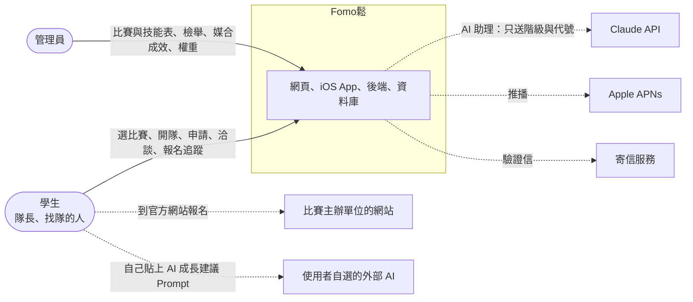
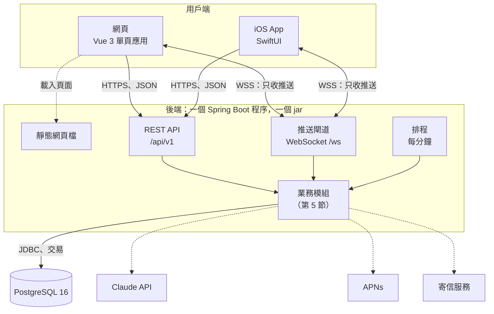
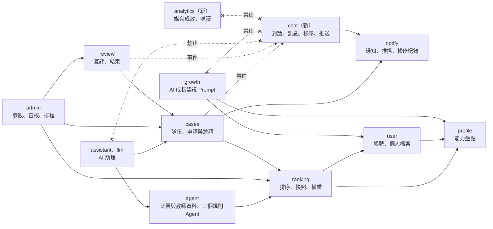
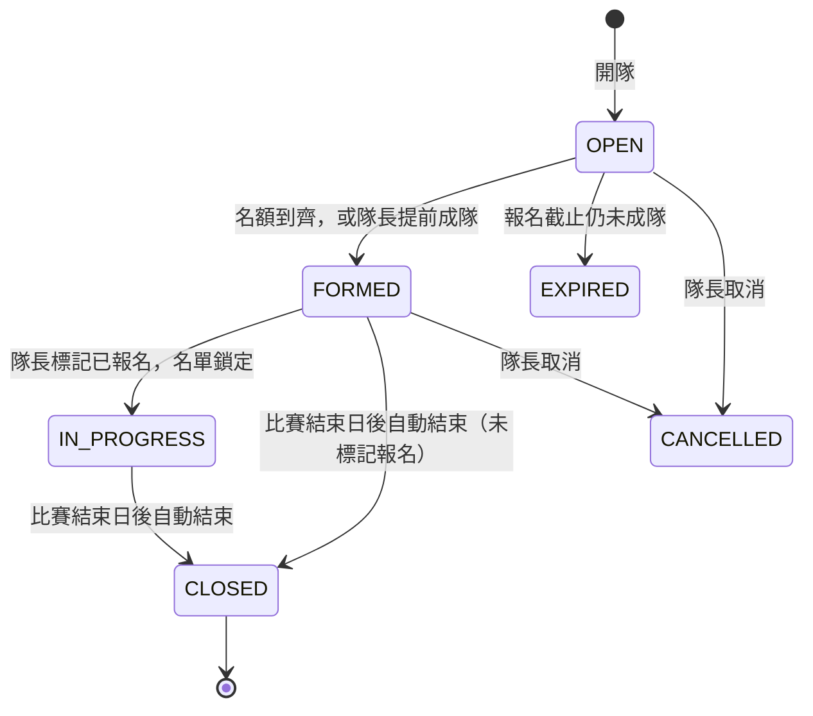
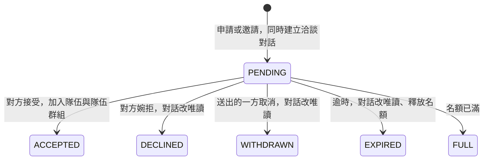
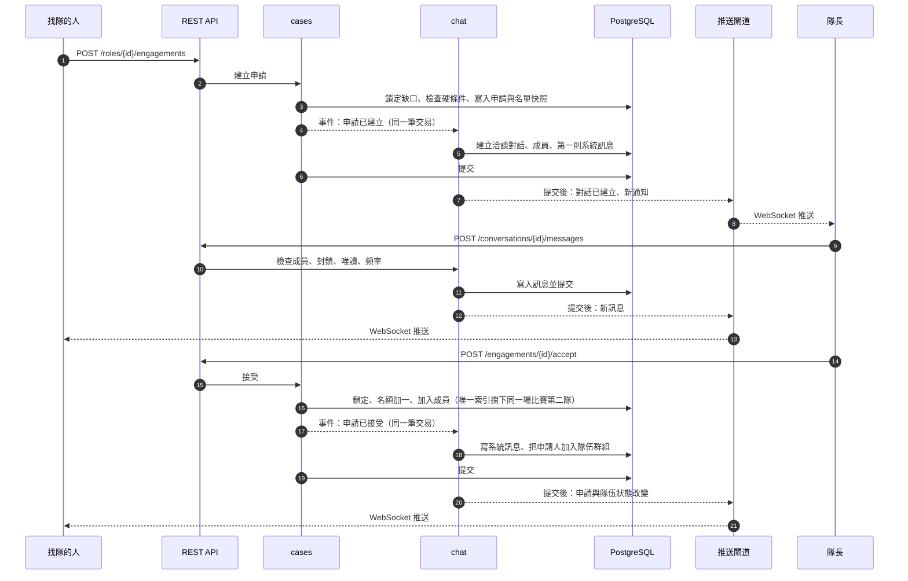
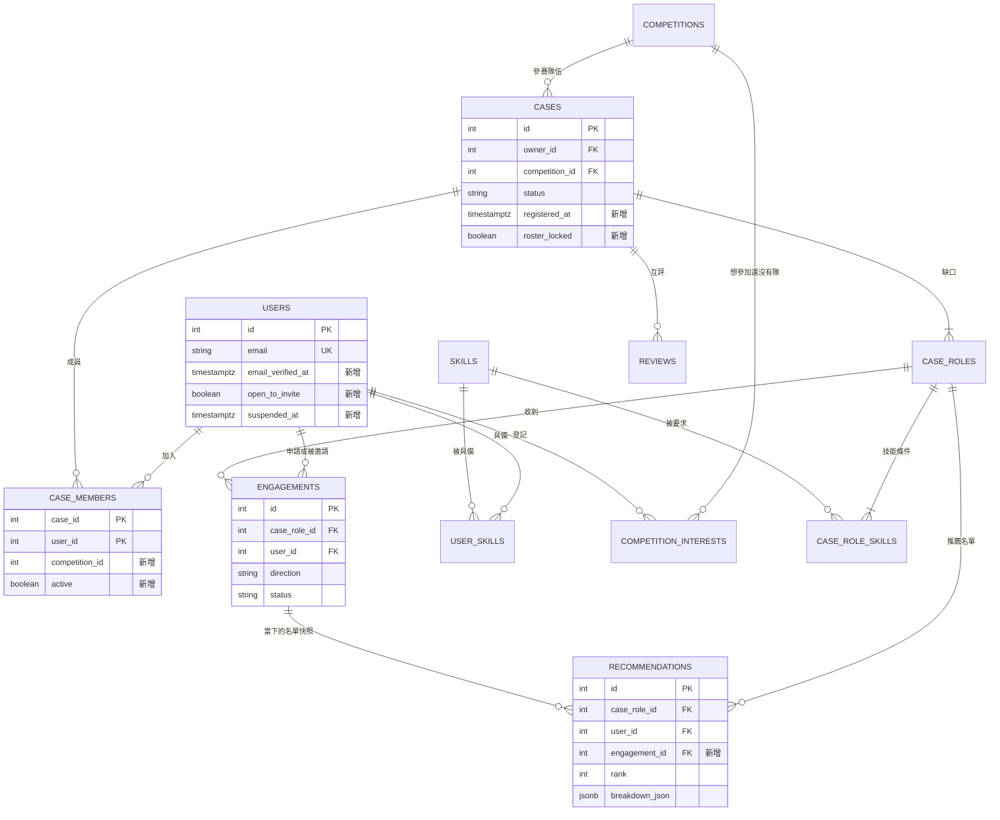
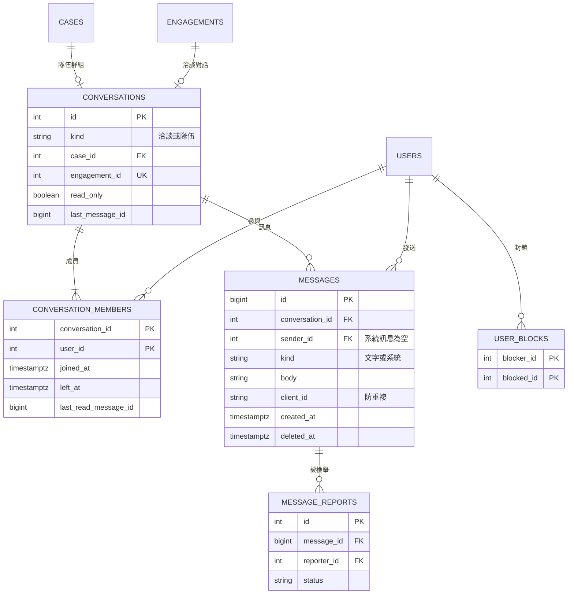
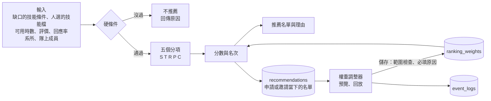
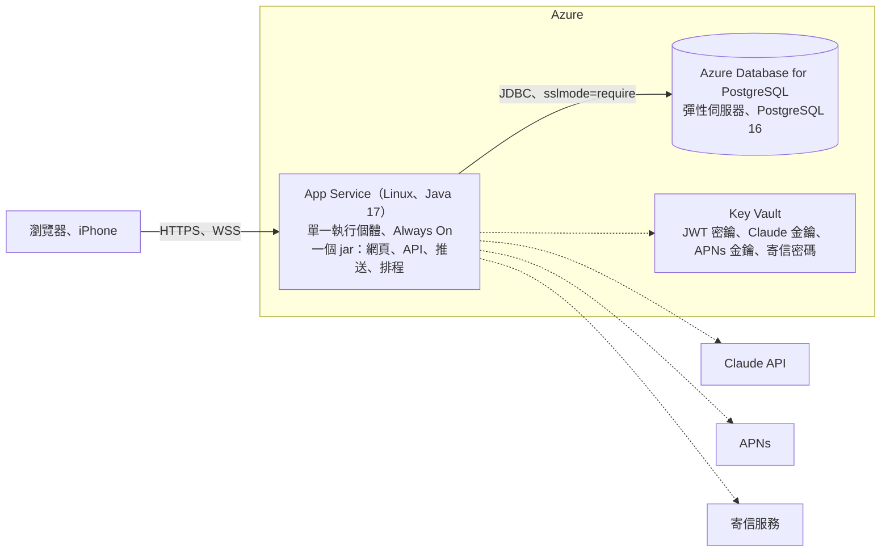

# Fomo鬆 軟體工程架構 3.1（草案）

2026-11-23 · Jack Peng

這份文件說明 3.1 的系統怎麼組成、模組怎麼分、資料怎麼存、訊息怎麼即時送達，以及怎麼開發、測試與部署。它對應《產品規格書 3.1》，取代先前的 README 3.0 草案。程式仍是 2.0（分支 `napai-2.0`，`9b39156`），尚未修改。

**標示**：【一手】讀現有程式或官方文件確認；【一手：實跑】2026-11-23 在本機執行 2.0 得到的結果；【推論】設計判斷。表格裡「3.1」欄位沒有另外標示的，都是設計草案，屬於推論。

**用語對照**【一手】：畫面上的「隊伍、缺口、申請或邀請、隊長」，在程式與資料表裡是 `case`、`case_role`、`engagement`、`owner`。3.1 不改這些名稱。

## 目錄

1. 結論
2. 架構目標與限制
3. 系統脈絡
4. 系統組成
5. 後端模組
6. 核心流程怎麼執行
7. 資料架構
8. API 架構
9. 即時通訊架構
10. 推薦排序與權重
11. AI 架構
12. 網頁前端架構
13. iOS 架構
14. 安全架構
15. 部署與環境
16. 排程、通知與設定
17. 品質要求對應
18. 測試架構
19. 開發流程
20. 模組責任與分工
21. 需求追溯
22. 架構決策
23. 風險與技術債
24. 來源

## 1 結論

**3.1 維持「一個程序、一個 jar、一個資料庫」的模組化單體，新增對話與分析兩個模組。隊伍的狀態改變用事件通知對話模組，推送一律在資料庫交易提交之後。**

| # | 重點 | 內容 | 層級 |
|---|---|---|---|
| 1 | 架構型態 | Spring Boot 3 一個程序同時提供網頁、REST API、WebSocket 推送與排程；資料庫是 PostgreSQL 16 | 一手（現況）加推論 |
| 2 | 規模 | 2.0：13 個套件、43 個 Java 檔、45 張資料表、104 個 API、13 個網頁畫面、18 個 Swift 檔。3.1：15 個套件、52 張資料表、122 個 API 加 1 個 WebSocket 端點、14 個畫面 | 2.0 為一手；3.1 為設計值 |
| 3 | 資料正確性 | 名額、同一場比賽一人一隊、對話的唯一性，都由資料庫的鎖與唯一索引保證，不只靠程式判斷 | 名額為一手；其餘為推論 |
| 4 | 即時通訊 | 寫入走 REST，WebSocket 只推送；斷線重連後用訊息編號補漏；連不上就改成 10 秒輪詢 | 推論 |
| 5 | 資料邊界 | 對話內容只有對話模組讀得到；AI 助理、成長 Prompt、分析三個模組禁止相依對話模組，用測試檢查 | 推論 |
| 6 | 上線前要處理的現況 | 設定的預設值是 Demo 模式，會重建資料庫；登入憑證 30 天有效且沒有停權機制；跨來源允許所有網域；沒有遷移腳本，也沒有 CI | 一手 |

**這份文件採用的決策**：你回覆「可以的」之後，我照上一則的預設處理。不同意的請直接說，文件改起來很快。

| 決策 | 內容 | 狀態 |
|---|---|---|
| D83 | 時間分項改為扣掉其他隊伍後的可用時數；跨系改為和整隊比 | 已定（依預設） |
| D72 | 比賽結束後的互評保留，放在主線之後 | 已定（依預設） |
| D80 | 同學版的找活動、組個局，這一版不放 | 已定（依預設） |
| D81 | 驗收日期、Demo 時間上限、成員分工 | 仍未定 |

## 2 架構目標與限制

| # | 目標 | 來源 | 架構上的做法 | 在哪一節 |
|---|---|---|---|---|
| 1 | 閉環完整、狀態一致 | 題目的驗收重點；規格書第 5、6 節 | 一個操作一筆交易；鎖定缺口；唯一索引；事件在同一筆交易內處理 | 6、7 |
| 2 | 訊息 2 秒內送達，斷線不漏 | 規格書第 14 節 | 提交後推送；用訊息編號補漏；輪詢備援 | 9 |
| 3 | 權限由伺服器判定 | 規格書第 12 節 | 登入憑證、角色、服務層檢查擁有者與成員身分 | 14 |
| 4 | 推薦可重現、可說明 | D37、D82 | 排序引擎是不相依框架的純 Java；保存名單快照；權重調整器 | 10 |
| 5 | 低耦合、高內聚、Java 物件導向 | 你先前對題目二的要求 | 模組化單體；模組之間用服務方法或事件；相依規則用測試檢查 | 5 |
| 6 | 網頁與 iOS 共用同一套 API | D36 | REST 加 JSON；推送協定兩邊相同 | 8、9、13 |
| 7 | 只蒐集必要的資料，對話不外流 | 規格書第 12 節 | 資料邊界；推播不含訊息內文；到期刪除 | 9、11、14 |

**限制**

1. 沿用 2.0 的程式與技術（D76）：Java、Spring Boot、PostgreSQL、Vue、SwiftUI。
2. 團隊人數少，驗收日期未定（D81），所以選改動最小的做法。
3. 先以單一執行個體上線；排程、AI 助理的背景執行緒本來就在同一個程序【一手】。
4. 沒有真實使用資料；容量數字都是設計目標，不是量測結果。

## 3 系統脈絡



| 外部對象 | 用途 | 平台傳出去的資料 | 現況 |
|---|---|---|---|
| Claude API | AI 助理 | 本人的學制、系所、技能階級與可信狀態；其他學生以代號表示（D56） | 已有【一手】；沒有金鑰或使用者未同意時改用規則模式 |
| Apple APNs | iOS 推播 | 通知的標題與內文；訊息類推播不含訊息內文 | 已有【一手】；未設定金鑰時只寫紀錄 |
| 寄信服務 | 信箱驗證 | Email 位址與驗證連結 | 新增；用哪一家待定 |
| 比賽主辦單位的網站 | 報名 | 無；平台只提供連結 | 連結欄位已有【一手】 |
| 使用者自選的外部 AI | AI 成長建議 | 無；由使用者自己複製貼上 | 已有【一手】 |
| 逢甲課程檢索系統 | 選填佐證的課綱擷取 | 無個資；只讀公開課綱 | 已有【一手】；可用設定關閉 |

## 4 系統組成



| 層 | 技術與版本【一手】 | 3.1 |
|---|---|---|
| 後端 | Spring Boot 3.3.5、Java 17；starter 只有 web、security、jdbc、test | 加 WebSocket 與寄信兩個 starter |
| 認證 | Spring Security 加 JWT（jjwt 0.12.6）；密碼用 BCrypt | 加停權與信箱驗證檢查 |
| 資料存取 | `NamedParameterJdbcTemplate` 手寫 SQL，包成一個 `Db` 類別；沒有 ORM | 沿用 |
| 資料庫 | PostgreSQL 16 | 加版本化的遷移腳本 |
| API 文件 | springdoc-openapi 2.6.0，路徑 `/swagger-ui.html` | 沿用 |
| 網頁 | Vue 3.5、vue-router 4.4（hash 路由）、Vite 5.4、Chart.js 4.4；建置結果放進 jar | 加即時連線模組與設計變數 |
| iOS | SwiftUI（iOS 17 以上）、URLSession；18 個 Swift 檔 | 加 WebSocket |
| 語言模型 | Claude API，用 JDK 內建的 `HttpClient` 呼叫，沒有額外 SDK | 沿用 |
| 推播 | APNs：HTTP/2 加 ES256 簽章，沒有第三方套件 | 沿用；改成提交後才送 |
| 工具 | Python 3（種子資料、端到端測試）、Node 加 Playwright（畫面冒煙測試） | 加即時與併發測試 |

## 5 後端模組

### 5.1 模組與相依

實線是程式相依，虛線是事件，打叉的虛線是禁止的相依。現有 13 個套件的相依關係是從 import 整理出來的【一手】；`chat` 與 `analytics` 是新增。



圖裡省略了每個模組都會用到的 `common`（資料存取、例外、目前登入者）與 `config`（JWT、安全設定、啟動初始化、時鐘）。

### 5.2 模組責任

| 模組 | 職責 | 主要類別【一手】 | 資料表 | API 數（2.0 → 3.1） | 3.1 變更 |
|---|---|---|---|---|---|
| `user` | 註冊登入、個人檔案、同意、開放被邀請、封鎖 | UserController、UserService、StatsService、CourseController | users、user_availability、consents、user_grades；新增 email_verifications、user_blocks | 20 → 26 | 註冊精簡、信箱驗證、開放被邀請、以技能找人、封鎖 |
| `profile` | 能力盤點：證據 → 技能分數與階級 | SkillProfileService | user_skills、skill_evidence、skill_level_history、user_credentials、credential_skills、user_awards、award_skills、level_bands、課程與證照的參考表 | — | 沿用；成績、證照、得獎改為選填佐證 |
| `agent` | 比賽與教師資料；競賽、學生、教師三個規則 Agent | AgentController、CatalogService、CompetitionAgent、StudentAgent、TeacherAgent | competitions、competition_skills、teachers、teacher_skills；新增 competition_interests | 17 → 21 | 學生提交比賽、找隊中名單 |
| `cases` | 隊伍、缺口、申請與邀請的狀態機、成隊、報名追蹤 | CaseController、CaseService | cases、case_roles、case_role_skills、engagements、case_members | 13 → 17 | 只建立比賽隊伍；提前成隊、退出與請離、標記已報名；發布事件 |
| `ranking` | 硬條件與計分、推薦名單、快照、權重 | RankingEngine、RankingService、RecommendationController | recommendations、ranking_weights、credibility_coefficients | 2 → 3 | D83 的兩個分項；快照不覆寫；權重範圍檢查；回放 |
| `review` | 互評、自動結束 | ReviewController、ReviewService | reviews；close_requests、close_votes 停用 | 5 → 3 | 標籤加相符度；結案投票停用 |
| `chat`（新） | 對話、訊息、已讀、檢舉、推送閘道 | 新增 | conversations、conversation_members、messages、message_reports | 0 → 7 | 全部新做 |
| `notify` | 站內通知、APNs、操作紀錄 | NotificationController、NotificationService、ApnsSender | notifications、device_tokens、event_logs | 3 → 3 | 加訊息類通知；推播改成提交後才送 |
| `analytics`（新） | 管理端的媒合成效 | 由 GrowthController 搬出 | 唯讀查詢，沒有自己的資料表 | 0 → 5 | 5 支 API 路徑不變 |
| `growth` | AI 成長建議 Prompt | GrowthController、GrowthService、GraphService | 唯讀 | 9 → 1 | 只留 Prompt；儀表板、圖譜、匯出停用；分析搬到 `analytics` |
| `assistant`、`llm` | AI 助理、Claude 客戶端、課綱與簡章擷取 | AssistantController、AssistantService、AssistantTools、ClaudeClient、ExtractController、ExtractService、SyllabusClient | agent_sessions、agent_messages、agent_steps、agent_actions、llm_calls | 16 → 16 | 入口改成浮動按鈕；後端不變 |
| `admin` | 參數、證據驗證、時鐘、排程 | AdminController、SchedulerService | system_params、award_matrix | 19 → 20 | 加停權；權重儲存改呼叫 `ranking` |
| `common`、`config` | Db、ApiException、GlobalExceptionHandler、Current；JwtFilter、JwtService、SecurityConfig、DbInit、DemoClock | — | — | — | 加 WebSocket 設定、遷移、啟動檢查 |

API 數合計：2.0 是 104【一手】；3.1 是 122（26 + 21 + 17 + 3 + 3 + 7 + 3 + 5 + 1 + 16 + 20）。

### 5.3 相依規則

| # | 規則 | 現況【一手】 | 怎麼檢查 |
|---|---|---|---|
| 1 | `common` 不相依任何業務模組 | 符合 | 架構測試掃描 import |
| 2 | 只有 `chat` 能讀寫四張對話資料表 | 新規則 | 架構測試掃描 SQL 字串 |
| 3 | `assistant`、`llm`、`growth`、`analytics` 不相依 `chat` | 新規則 | 架構測試掃描 import |
| 4 | `RankingEngine` 不相依 Spring 與資料庫 | 符合：純 Java，有單元測試 | 架構測試掃描 import |
| 5 | Controller 只呼叫本模組的 Service；跨模組經由 Service 的公開方法或事件 | 大致符合 | 程式檢視 |
| 6 | 模組之間不形成循環相依 | 有一處：`config` 與 `profile` 互相引用 | 架構測試；這一處列為技術債 |
| 7 | `analytics` 可以跨表查詢，但只能讀 | 新規則 | 架構測試：SQL 只能以 SELECT 開頭 |

### 5.4 分層

每個模組內都是三層，沒有另外的 Repository 層【一手】。

| 層 | 內容 | 規則 |
|---|---|---|
| Controller | 路由、取得目前登入者、把請求轉給 Service | 不寫 SQL、不寫業務規則 |
| Service | 業務規則、權限檢查、交易邊界（`@Transactional`）、發布事件 | 一個使用者操作對應一個公開方法 |
| `Db` | 具名參數的 SQL；查詢結果以 Map 回傳 | 不含業務判斷 |

例外是 `RankingEngine`：它不屬於任何一層，是一個只吃輸入、吐結果的類別，由 `RankingService` 從資料庫組好輸入後呼叫【一手】。

## 6 核心流程怎麼執行

### 6.1 隊伍的狀態



狀態值沿用現有的【一手】。2.0 另有 `DRAFT` 與 `CLOSING`：3.1 開隊後直接是 `OPEN`，結案投票停用後不再進入 `CLOSING`。

### 6.2 申請與邀請的狀態



申請與邀請共用同一張表與同一個狀態機，用方向欄位區分（D17）【一手】。

### 6.3 從申請到成隊



### 6.4 交易與一致性規則

| # | 規則 | 現況【一手】 | 3.1 |
|---|---|---|---|
| 1 | 一個使用者操作是一筆資料庫交易 | 符合：服務層方法標 `@Transactional` | 沿用 |
| 2 | 會搶同一個名額的操作，先鎖缺口那一列 | 符合：`FOR UPDATE` | 沿用 |
| 3 | 隊伍的狀態改變，對話要跟著變 | 沒有對話 | `cases` 在交易內發布事件，`chat` 在同一筆交易內寫系統訊息與成員異動。不會出現「申請成立了卻沒有對話」 |
| 4 | 推送、推播、寄信在交易提交後才做 | 不符合：有設定推播時，會在交易內同步呼叫 Apple | 改成提交後的事件；失敗只記錄，不回滾 |
| 5 | 排程與使用者操作走同一套 Service 方法 | 符合：排程呼叫 `cases`、`review` 的方法 | 沿用；新增的排程也照這個做法 |
| 6 | 寫入的操作都留下操作紀錄 | 符合：狀態變更寫入 `event_logs` | 加上報名、退出與請離、檢舉、停權、權重變更 |

**事件清單**（都由 `cases` 或 `review` 在交易內發布）

| 事件 | `chat` 的處理 | 推送給誰 |
|---|---|---|
| 隊伍已建立 | 建立隊伍群組，隊長加入 | 隊長 |
| 申請或邀請已建立 | 建立洽談對話、兩位成員、系統訊息 | 對方 |
| 已接受 | 系統訊息；申請人加入隊伍群組；洽談對話不再有操作按鈕 | 雙方與隊伍成員 |
| 已婉拒、已取消、已逾時 | 系統訊息；洽談對話改唯讀 | 雙方 |
| 已成隊 | 隊伍群組的系統訊息 | 隊伍成員 |
| 成員退出、被請離 | 系統訊息；該成員在群組標記離開時間 | 隊伍成員 |
| 已標記報名 | 系統訊息；名單鎖定 | 隊伍成員 |
| 報名提醒（7、3、1 天） | 隊伍群組的系統訊息 | 隊伍成員 |
| 隊伍已結束 | 系統訊息；開始計算訊息保存期限 | 隊伍成員 |

## 7 資料架構

### 7.1 資料表分組

2.0 有 45 張表【一手】，3.1 新增 7 張，合計 52 張。

| 組 | 資料表 | 3.1 | 負責模組 |
|---|---|---|---|
| 參考資料 | colleges、departments、skills、level_bands、award_matrix | 保留 | `user`、`profile`、`admin` |
| 選填佐證的參考資料 | courses、course_skill_map、course_syllabus、certificate_catalog、certificate_catalog_skills | 保留 | `profile`、`llm` |
| 比賽與教師 | competitions、competition_skills、teachers、teacher_skills | 保留；competitions 加欄位 | `agent` |
| 使用者 | users、user_availability、user_skills、skill_evidence、consents | 保留；users 加欄位 | `user`、`profile` |
| 使用者的選填佐證 | user_grades、user_credentials、credential_skills、user_awards、award_skills、skill_level_history | 保留 | `profile` |
| 隊伍 | cases、case_roles、case_role_skills、engagements、case_members | 保留；cases、case_members 加欄位 | `cases` |
| 評價與推薦 | reviews、recommendations | 保留；各加欄位 | `review`、`ranking` |
| 結案投票 | close_requests、close_votes | 停用，不刪 | `review` |
| AI 助理 | agent_sessions、agent_messages、agent_steps、agent_actions、llm_calls | 保留 | `assistant`、`llm` |
| 參數 | ranking_weights、credibility_coefficients、system_params | 保留 | `ranking`、`admin` |
| 通知與稽核 | notifications、device_tokens、event_logs | 保留 | `notify` |
| 對話（新） | conversations、conversation_members、messages、message_reports | 新增 | `chat` |
| 帳號延伸（新） | user_blocks、email_verifications | 新增 | `user` |
| 找隊中名單（新） | competition_interests | 新增 | `agent` |

### 7.2 核心關聯

組隊：



對話：



### 7.3 欄位變更

| 資料表 | 變更 | 用途 | 和 README 3.0 草案相比 |
|---|---|---|---|
| users | 加 `email_verified_at`、`open_to_invite`、`suspended_at`；`student_no` 改成可空 | 信箱驗證；開放被邀請；停權；學號選填（待確認） | `suspended_at` 是新加的 |
| cases | 加 `registered_at`、`registered_by`、`roster_locked`；`team_size` 的下限由 2 改成 1 | 報名追蹤與名單鎖定；允許一人成隊（D69） | `team_size` 是新加的；現在的檢查條件是至少 2 人【一手】 |
| case_members | 加 `competition_id`、`active` | 同一場比賽一人一隊的唯一索引 | 新加的 |
| competitions | 加 `submitted_by` | 學生提交的比賽；審核沿用現有的核准欄位 | 相同 |
| reviews | 加 `tags`（最多 3 個）；相符度保留；另外三項分數不再填 | 標籤式互評 | 相同 |
| recommendations | 加 `engagement_id` | 申請或邀請當下的名單快照；有值的列不覆寫 | 新加的 |
| system_params | 加提醒天數（7、3、1）、對話保存天數（90）、預設需求時數、訊息頻率上限 | 可調參數 | 多了訊息頻率上限 |

簡化後的開隊表單對應到現有結構：一支隊伍一個預設缺口，名額等於「還缺幾人」，技能條件寫入 `case_role_skills`，勾「一定要會」的技能才設為必要。

### 7.4 新增資料表

| 資料表 | 用途 | 主要欄位 |
|---|---|---|
| conversations | 對話 | 種類（洽談或隊伍）、隊伍、對應的申請（洽談才有）、是否唯讀、最後一則訊息 |
| conversation_members | 誰在對話裡 | 對話、使用者、加入與離開時間、最後已讀的訊息編號 |
| messages | 訊息 | 對話、發送者（系統訊息為空）、種類、內容、用戶端編號、時間、刪除時間 |
| message_reports | 檢舉 | 訊息、檢舉人、理由、處理狀態、處理人與時間 |
| user_blocks | 封鎖 | 封鎖者、被封鎖者、時間 |
| competition_interests | 「我想參加，還沒有隊」 | 比賽、使用者、時間 |
| email_verifications | 信箱驗證 | 使用者、驗證碼的雜湊、到期時間、使用時間 |

### 7.5 完整性規則

「資料庫設計與資料正確性」佔 15 分。下表每一條規則都落在資料庫的限制或鎖上。

| # | 規則 | 機制 | 現況 |
|---|---|---|---|
| 1 | 名額不超收 | 檢查條件 `filled_count <= headcount`，加上接受時鎖定缺口 | 已有【一手】 |
| 2 | 同一個缺口、同一個人只有一筆待回覆 | 部分唯一索引 `uq_engagement_pending` | 已有【一手】 |
| 3 | 同一場比賽一人一隊 | `case_members (competition_id, user_id)` 的部分唯一索引，只算 `active` 的列；隊伍取消、過期或成員離開時，在同一筆交易把 `active` 設為否 | 新增 |
| 4 | 每筆申請只有一個洽談對話；每支隊伍只有一個隊伍群組 | 兩個唯一索引 | 新增 |
| 5 | 同一則訊息重送不會變成兩則 | `messages (sender_id, client_id)` 唯一；重送時回傳原本那一則 | 新增 |
| 6 | 名單鎖定後不能加人、退出、請離 | 服務層在交易內檢查 `roster_locked` | 新增 |
| 7 | 只有對話成員能讀寫；離開後看不到之後的訊息 | 查詢一律帶成員條件與離開時間 | 新增 |
| 8 | 權重總和 1.00、每項 0 至 0.60、技能不低於 0.30 | 伺服器檢查，寫入操作紀錄 | 要改：現在只檢查總和【一手】 |
| 9 | 技能分數 0 至 100、階級 0 至 3、互評 1 至 5 | 檢查條件 | 已有【一手】 |

### 7.6 資料庫版本與遷移

| 項目 | 現況【一手】 | 3.1 |
|---|---|---|
| 建表方式 | 啟動時執行 `schema.sql`；它先刪除再建立全部資料表 | 現有結構定為基準版；之後每次變更一支遷移腳本 |
| 什麼時候執行 | `APP_RESET_ON_START=true` 時每次啟動都重建；設成 false 時只在資料表不存在時建立 | 啟動時只執行還沒跑過的腳本 |
| 已有資料時加欄位 | 做不到，只能重建 | 做得到 |
| 工具 | 沒有 | Flyway；PostgreSQL 需要另外加 `flyway-database-postgresql` 這個模組【一手：Redgate 文件】 |
| Demo 重置 | `/admin/reset` 與啟動重建 | 保留給 Demo 模式；正式模式停用 |

### 7.7 保存與刪除

| 資料 | 規則 | 由誰執行 |
|---|---|---|
| 帳號與個人檔案 | 畢業 3 個月去識別化、6 個月刪除；本人可隨時刪除（D26 至 D28） | 現有排程與 `DELETE /me`【一手】 |
| 訊息內容 | 隊伍結束後 90 天清空內容，保留編號與時間（待確認） | 新增排程 |
| 被檢舉的訊息 | 處理完成前不清空 | 新增排程要排除 |
| 信箱驗證碼 | 到期或使用後刪除 | 新增排程 |
| 去識別化的隊伍與互評 | 保留供分析（D28） | 現有【一手】 |
| 操作紀錄、權重變更紀錄 | 長期保留 | — |

## 8 API 架構

### 8.1 慣例【一手】

| 項目 | 內容 |
|---|---|
| 前綴 | `/api/v1` |
| 格式 | JSON |
| 認證 | `Authorization: Bearer <JWT>`；註冊、登入、`/meta`、`/health` 不需要 |
| 管理端 | `/admin/**` 與 `/analytics/**` 需要管理員角色 |
| 錯誤格式 | `{code, message, reasons[]}` |
| 狀態碼 | 400 格式錯誤、401 未登入、403 沒有權限、404 找不到、409 狀態衝突、422 沒過硬條件（`reasons` 列出原因） |
| 文件 | 啟動後在 `/swagger-ui.html` |

3.1 新增兩個慣例：讀訊息用 `after` 與 `limit` 分頁；送訊息帶 `clientId`，重送不會重複。

### 8.2 新增（23 支，另加 1 個 WebSocket 端點）

| 模組 | 方法與路徑 | 用途 | 誰能用 |
|---|---|---|---|
| `user` | `POST /auth/verify-email`、`POST /auth/resend-verification` | 信箱驗證 | 註冊者 |
| `user` | `PUT /me/open-to-invite` | 開放或關閉被邀請 | 本人 |
| `user` | `GET /people?skill=` | 以技能找人，只回開放被邀請者 | 已驗證的學生 |
| `user` | `POST`、`DELETE /users/{id}/block` | 封鎖與解除 | 本人 |
| `agent` | `POST /competitions` | 學生提交比賽 | 已驗證的學生 |
| `agent` | `POST`、`DELETE /competitions/{id}/interest` | 掛上或取消「我想參加，還沒有隊」 | 本人 |
| `agent` | `GET /competitions/{id}/interested` | 這場比賽的找隊中名單 | 已驗證的學生 |
| `cases` | `POST /cases/{id}/form` | 提前成隊 | 隊長 |
| `cases` | `POST /cases/{id}/leave` | 退出隊伍 | 成員，報名前 |
| `cases` | `DELETE /cases/{id}/members/{userId}` | 請人離開 | 隊長，報名前 |
| `cases` | `POST /cases/{id}/registration` | 標記已報名，鎖定名單 | 隊長 |
| `chat` | `GET /conversations` | 我的對話列表與未讀數 | 本人 |
| `chat` | `GET /conversations/{id}/messages?after=&limit=` | 讀訊息；`after` 用來補漏 | 對話成員 |
| `chat` | `POST /conversations/{id}/messages` | 送訊息 | 對話成員，非唯讀 |
| `chat` | `POST /conversations/{id}/read` | 更新已讀位置 | 對話成員 |
| `chat` | `POST /messages/{id}/report` | 檢舉 | 對話成員 |
| `chat` | `GET /admin/reports`、`POST /admin/reports/{id}/resolve` | 檢舉處理 | 管理員 |
| `admin` | `PUT /admin/users/{id}/suspension` | 停權與解除 | 管理員 |
| `ranking` | `GET /admin/ranking/replay` | 用保存的名單重算候選權重 | 管理員 |
| `chat` | `WS /ws` | 推送 | 已登入者 |

### 8.3 修改

| 現有路徑【一手】 | 修改 |
|---|---|
| `POST /auth/register` | 欄位減為 Email、密碼、姓名、系所、學制年級，加同意與開放被邀請的選擇 |
| `POST /cases` | 只建立比賽隊伍；接受精簡欄位；技能條件至少 1 項；同一筆交易建立隊伍群組 |
| `POST /roles/{roleId}/engagements` | 同一筆交易建立洽談對話、第一則系統訊息、名單快照 |
| `POST /engagements/{id}/accept`、`/decline`、`/withdraw` | 發布事件；接受時檢查同一場比賽一人一隊 |
| `GET /roles/{roleId}/recommendations` | 只列開放被邀請者；排除同一場比賽已在其他隊的人；D83 的兩個分項 |
| `GET /me/recommended-cases` | 供隊伍牆的「適合我」使用；同樣套用 D83 |
| `POST /cases/{id}/reviews` | 內容改成標籤加相符度 |
| `PUT /admin/params` | 權重加範圍檢查、必填原因、寫入操作紀錄 |
| `POST /me/growth-prompt` | 用語改成隊伍；可選一場目標比賽 |
| `/analytics/*`（5 支） | 路徑不變，搬到 `analytics` 模組；推薦品質改讀不覆寫的快照 |

### 8.4 停用（5 支）

`POST /cases/{id}/close-requests`、`POST /close-requests/{id}/votes`、`GET /me/growth`、`GET /me/growth/graph`、`GET /me/growth/obsidian`。路徑先保留，畫面不再呼叫。

## 9 即時通訊架構

### 9.1 元件

| 元件 | 職責 |
|---|---|
| 對話服務 | 對話、成員、訊息的讀寫；權限、唯讀、封鎖、頻率檢查 |
| 事件處理 | 接收 `cases`、`review` 的事件，寫系統訊息、調整成員 |
| 推送閘道 | 管理 WebSocket 連線；交易提交後把事件送給線上的成員 |
| 連線表 | 使用者編號 → 目前的連線；放在記憶體 |
| 離線通知 | 成員不在線上時，寫站內通知並送 APNs |

### 9.2 WebSocket 協定

用原生的 WebSocket 加 JSON，不用 STOMP。用戶端只送兩種訊息，其餘都是伺服器推送。

| 方向 | `type` | 內容 | 說明 |
|---|---|---|---|
| 用戶端 → 伺服器 | `auth` | 登入憑證 | 連線後第一則；5 秒內沒有就關閉 |
| 用戶端 → 伺服器 | `ping` | — | 每 25 秒一次，維持連線 |
| 伺服器 → 用戶端 | `ready` | 使用者編號 | 驗證通過 |
| 伺服器 → 用戶端 | `message.new` | 對話編號、訊息 | 新訊息，含系統訊息 |
| 伺服器 → 用戶端 | `conversation.updated` | 對話編號、是否唯讀、成員異動 | 對話狀態改變 |
| 伺服器 → 用戶端 | `engagement.updated` | 申請編號、狀態 | 申請或邀請狀態改變 |
| 伺服器 → 用戶端 | `team.updated` | 隊伍編號、狀態、剩餘名額 | 隊伍狀態改變 |
| 伺服器 → 用戶端 | `notification.new` | 通知、未讀數 | 小鈴鐺 |
| 伺服器 → 用戶端 | `error` | 代碼、訊息 | 例如憑證失效 |

### 9.3 送達與補漏

| 項目 | 做法 | 理由 |
|---|---|---|
| 寫入 | 送訊息走 REST，存進資料庫後才推送 | 權限與錯誤處理只寫一次；推送失敗不影響保存 |
| 順序 | 以訊息編號為準 | 編號由資料庫產生，同一個對話內遞增 |
| 重複 | 用戶端以訊息編號去重；送出時帶 `clientId` | 重連與重送都可能造成重複 |
| 補漏 | 重連後呼叫 `GET …/messages?after=<最後一則的編號>` | 斷線期間的訊息不會漏 |
| 未讀 | 每個成員記最後已讀的訊息編號 | 列表與小鈴鐺由它算未讀數 |
| 降級 | 連不上 WebSocket 時，每 10 秒輪詢對話列表 | 有些網路會擋 WebSocket |
| 離線 | 成員沒有連線時，寫站內通知並送 APNs；推播只寫「你有新訊息」 | 訊息內文不經過 Apple |
| 驗證 | 憑證放在第一則訊息，不放網址 | 網址會進存取紀錄 |

### 9.4 權限與防濫用

1. 讀寫訊息前，檢查使用者是對話成員且尚未離開。
2. 洽談對話在婉拒、取消、逾時後唯讀；隊伍結束後群組唯讀。
3. 被對方封鎖時，不能再對他申請、邀請、傳訊。
4. 信箱未驗證或被停權的帳號不能傳訊。
5. 每則訊息最多 2,000 字；每人每分鐘最多 30 則。這兩個數字是我建議的起始值【推論】，放在系統參數。
6. 訊息一律當純文字顯示。
7. 管理員沒有瀏覽對話的 API，只有檢舉處理看得到被檢舉的那一則。

### 9.5 容量與擴充

| 項目 | 3.1 | 之後要擴充時 |
|---|---|---|
| 執行個體 | 一台；連線表放記憶體 | 多台時，每台用資料庫的通知機制或訊息匯流排互相轉發 |
| 部署平台 | Azure App Service 的 Linux 方案一律啟用 WebSocket，不用另外設定；Free 方案最多 5 條連線【一手：Microsoft Learn，2026-08-24 版】 | B1 以上方案的連線數上限，上線前要查 |
| 重新部署 | 連線會斷；用戶端自動重連並補漏 | 不用改 |

第一版不做：圖片與檔案、語音、已讀回條、輸入中提示、訊息搜尋、端對端加密。

## 10 推薦排序與權重



| 項目 | 現況【一手】 | 3.1 |
|---|---|---|
| 引擎 | `RankingEngine`：純 Java，吃一個缺口、一位人選、一組權重，吐出是否通過、分數、五個分項、理由 | 型態不變 |
| 雙向 | 隊長看人選與學生看隊伍，用同一個引擎 | 不變 |
| 硬條件 | 身分、必要技能、時間、名額 | 加開放被邀請、同一場比賽 |
| 時間分項（D83） | min(可投入時數 ÷ 需求時數, 1) × 期間重疊比例；通過硬條件後幾乎都是 1 | 可用時數 = 每週可投入時數 − 其他進行中隊伍的需求時數合計；輸入多一個「已承諾時數」 |
| 跨系分項（D83） | 和隊長的學院、系所比 | 和整隊比；輸入多一組「隊上已有的學院與系所」 |
| 權重 | 每次計算從 `ranking_weights` 讀取 | 不變 |
| 快照 | 隊長每看一次就整份覆寫；被接受的人之後不在名單裡【一手：實跑】 | 申請或邀請成立時，另存一份帶申請編號的名單，不覆寫 |
| 權重儲存 | `PUT /admin/params` 只檢查總和 | 加範圍檢查、必填原因、操作紀錄 |
| 名次預覽 | 沒有 | 在瀏覽器算：推薦 API 已經回傳每個人的五個分項，換權重重算即可，不用新 API |
| 回放 | 沒有 | `GET /admin/ranking/replay`：用保存的名單，算被接受的人在候選權重下的名次 |
| 單元測試 | 排序引擎 10 項 | D83 的兩個分項要改寫並補測試 |

權重的依據、合理性檢查與調整器的規格，在《產品規格書 3.1》第 8.4 至 8.7 節。

## 11 AI 架構

| 項目 | AI 助理 | AI 成長建議 Prompt |
|---|---|---|
| 模組 | `assistant`、`llm`、`agent` | `growth` |
| 誰把資料送到 AI | 後端呼叫 Claude API | 使用者自己複製貼上；後端不對外呼叫 |
| 送出的內容 | 只有階級與可信狀態；其他學生以代號表示（D56） | 本人的分數、成績、得獎；只有本人看得到 |
| 沒有金鑰或未同意時 | 改用規則模式，功能照常【一手】 | 不受影響 |
| 會不會改資料 | 不會直接改；只產生待確認動作，使用者按確認才執行（D59） | 不會 |
| 執行方式 | 背景執行緒池，4 條【一手】 | 一次請求內完成 |
| 3.1 變更 | 入口改成浮動按鈕 | 移到個人頁；用語改成隊伍 |

**三條邊界**

1. 分數由規則計算，語言模型不改數字（沿用 2.0 的設計原則【一手】）。
2. 對話內容不進任何 AI 功能：`assistant`、`llm`、`growth` 不能相依 `chat`（第 5.3 節規則 3）。
3. AI 成長建議 Prompt 不含隊友姓名、評語原文、隊伍名稱、對話內容（D32）。

## 12 網頁前端架構

| 項目 | 現況【一手】 | 3.1 |
|---|---|---|
| 框架 | Vue 3 單頁應用；`vue-router` 的 hash 路由；13 個畫面、10 個元件 | 14 個畫面；畫面全部重做，沿用框架 |
| 狀態 | 一個 `store.js`：登入者、參考資料、未讀數 | 加對話列表與未讀數 |
| API 客戶端 | 一個 `api.js`：自動帶憑證；401 時導向登入 | 沿用 |
| 即時 | 沒有 | 新增 `realtime.js`：連線、驗證、心跳、自動重連、補漏、輪詢備援；畫面訂閱事件 |
| 樣式 | 一個 `style.css` | 新增設計變數檔，值取自同學版（規格書第 11 節） |
| 憑證存放 | `localStorage` | 沿用；所有使用者輸入都當純文字顯示，不用 `v-html` |
| 建置 | Vite 建置後複製到後端的 `static/`，和 API 同一個來源 | 沿用 |
| AI 助理 | 獨立一頁 | 全站的浮動元件，訊息頁不顯示 |

**路由**

| 路徑 | 畫面（規格書第 11 節的編號） |
|---|---|
| `/login` | 1 註冊與登入 |
| `/` | 2 找隊友 |
| `/competitions`、`/competitions/:id` | 3 比賽清單、4 比賽頁 |
| `/people` | 5 找人 |
| `/messages`、`/messages/:id` | 6 洽談、7 隊伍群組 |
| `/teams/:id/review` | 8 互評 |
| `/me`、`/me/manage` | 9 個人頁、10 個人管理 |
| `/notifications` | 11 通知 |
| `/admin`、`/admin/weights` | 13 管理端、14 排序權重調整器 |

第 12 個畫面（AI 助理）是浮動面板，沒有自己的路徑。

## 13 iOS 架構

| 項目 | 現況【一手】 | 3.1 |
|---|---|---|
| 技術 | SwiftUI，iOS 17 以上；URLSession 的 async/await | 沿用 |
| 結構 | 18 個 Swift 檔：模型、API 客戶端、App 狀態、各畫面 | 分頁改成找隊友、比賽、訊息、我 |
| 即時 | 沒有 | 前景用系統的 WebSocket 介面，協定和網頁相同；背景靠 APNs |
| 推播 | APNs 已串接 | 加訊息類推播 |
| 檢查 | 有 API 契約檢查與型別檢查的腳本；沒有在 Xcode 建置過 | 上線前要在 Mac 上建置一次 |
| 時程 | — | 網頁定案後才跟進（D75） |

## 14 安全架構

| 控制 | 現況【一手】 | 3.1 |
|---|---|---|
| 認證 | JWT，HMAC 簽章，30 天到期；放在 Authorization 標頭 | 不變 |
| 密碼 | BCrypt 雜湊 | 不變 |
| 授權 | 三層：登入 → 角色（學生、管理員）→ 服務層檢查擁有者與狀態 | 對話加「是成員且未離開」；隊長才能成隊、標記報名、請離 |
| 停權 | 沒有；憑證到期前都有效 | `users.suspended_at`；每次請求確認帳號狀態，可快取 60 秒 |
| 信箱驗證 | 沒有 | 未驗證不能申請、邀請、傳訊 |
| 跨來源 | 允許所有來源 | 正式環境只允許自己的網域 |
| 未預期的錯誤 | 把例外訊息回給用戶端 | 改成固定訊息加追蹤編號；細節只寫進紀錄 |
| 密鑰 | JWT 密鑰有預設值；其餘由環境變數提供 | 正式模式用預設密鑰就拒絕啟動；密鑰放 Key Vault |
| WebSocket | 沒有 | 第一則訊息驗證；憑證不放網址；逾時關閉 |
| 輸入 | 服務層檢查 | 訊息長度與頻率上限 |
| 輸出 | Vue 預設會跳脫；只有知識圖譜一處用 `v-html` | 知識圖譜停用後不再使用 `v-html` |
| 稽核 | 狀態變更寫入 `event_logs` | 加上檢舉處理、停權、權重變更 |
| Demo 開關 | `/admin/reset` 與 `/admin/clock` 由 `APP_DEMO_CLOCK` 控制，預設開啟 | 正式環境關閉；啟動時檢查開關的組合 |
| 傳輸 | 部署時用 HTTPS | 不變；WebSocket 用 WSS |

個資與同意條款的規則在《產品規格書 3.1》第 12 節。

## 15 部署與環境



部署方式沿用 2.0 的 README 第 15 節【一手】：App Service（Linux、Java 17、B1 以上、開啟 Always On 排程才會跑）、Azure Database for PostgreSQL 彈性伺服器、金鑰放 Key Vault、iOS 走 TestFlight。

**三種環境**

| 環境 | `APP_SEED_MODE` | `APP_RESET_ON_START` | `APP_DEMO_CLOCK` | 用途 |
|---|---|---|---|---|
| 本機開發 | demo | true | true | `docker compose` 只跑資料庫；後端用 Maven、網頁用 Vite 開發伺服器 |
| Demo 與評審 | demo | true | true | 50 位虛構學生；每次重啟回到初始狀態；可以快轉時間 |
| 正式 | reference | false | false | 只載入學校參考資料；不重建；不能調時鐘 |

三個開關的預設值都是 Demo 那一組【一手】。正式環境少設一個，重啟就可能清掉資料，所以 3.1 加啟動檢查：`reference` 模式下另外兩個必須是 false，JWT 密鑰不能是預設值，否則拒絕啟動。

**3.1 新增的設定**（名稱是草案）

| 設定 | 用途 |
|---|---|
| 寄信主機、帳號、密碼、寄件人 | 信箱驗證 |
| 允許的來源網域 | 跨來源限制 |
| 學校信箱網域 | 註冊時檢查（待確認） |

## 16 排程、通知與設定

排程每分鐘執行一次，同一個程序內一次只跑一輪【一手】。

| 排程 | 現況【一手】 | 3.1 |
|---|---|---|
| 回覆提醒 | 到期前 24 小時提醒 | 沿用 |
| 逾時 | 申請或邀請逾時、隊伍截止未成隊 | 沿用；加寫系統訊息 |
| 結案投票逾時 | 有 | 停用 |
| 自動結束 | 結束日後自動結案 | 改成比賽結束日後自動結束並開放互評 |
| 互評逾時 | 有 | 沿用 |
| 畢業生命週期 | 提醒、去識別化、刪除 | 沿用 |
| 報名提醒 | 沒有 | 新增：截止前 7、3、1 天 |
| 訊息到期 | 沒有 | 新增：隊伍結束 90 天後清空內容 |
| 驗證碼清理 | 沒有 | 新增 |

通知有三個出口：站內通知（寫入 `notifications`）、WebSocket 的 `notification.new`、APNs。可調的參數都在 `system_params` 與 `ranking_weights`，由管理端修改【一手】。

## 17 品質要求對應

| 品質要求 | 規格書的要求 | 架構手段 | 怎麼驗 |
|---|---|---|---|
| 即時性 | 訊息 2 秒內出現；斷線補回 | 提交後推送；訊息編號補漏；輪詢備援 | 兩個連線互傳的自動化測試 |
| 權限 | 非參與者讀不到對話 | 服務層檢查成員身分；沒有管理員瀏覽對話的 API | 端到端測試逐支檢查 |
| 資料正確性 | 名額不超收；同一場比賽一人一隊 | 鎖定缺口；唯一索引 | 併發測試 |
| 可說明性 | 同樣的資料得到同樣的名次；可展開看依據 | 純函式引擎；名單快照；權重調整器 | 單元測試；調整器和引擎逐筆對照 |
| 可維護性 | — | 模組化單體；事件；相依規則 | 架構測試 |
| 隱私 | 對話不送外部 AI；到期刪除 | 模組邊界；推播不含內文；排程刪除 | 架構測試；排程測試 |
| 可用性 | — | 單一執行個體；重啟後用戶端自動重連並補漏 | 重啟測試 |
| 效能 | 隊伍牆與推薦 1 秒內回應（示範資料量） | 引擎在記憶體計算；一次查詢取回所有人選的統計【一手】 | 測試腳本量測 |
| 可稽核 | 重要操作留紀錄 | `event_logs` | 查表 |

## 18 測試架構

| 層級 | 工具【一手】 | 2.0 現況 | 3.1 要加 |
|---|---|---|---|
| 單元 | JUnit，`./mvnw test` | 27 項：排序引擎 10、能力盤點 9、三個 Agent 8 | D83 的兩個分項、名單鎖定、對話權限與唯讀、互評標籤計分、權重範圍檢查 |
| 端到端（API） | Python：`demo_e2e.py`、`napai_e2e.py`、`reference_smoke.py` | 8 步閉環；AI 助理 79 項（對測試替身）；正式模式 20 項 | 主線七步；三則範例的技能需求；非成員讀對話被拒；停權後被拒 |
| 即時 | 新增腳本 | 沒有 | 兩個連線互傳；斷線重連補漏；未驗證的連線被關閉 |
| 併發 | 新增腳本 | 沒有 | 兩人同時搶最後一個名額只成功一個；同一人同時被兩隊接受只成功一個 |
| 畫面冒煙 | Playwright，`ui_smoke.cjs` | 14 個畫面 | 3.1 的 14 個畫面，電腦與手機寬度 |
| 架構規則 | 新增單元測試 | 沒有 | 第 5.3 節的 7 條規則 |
| 排序對照 | 新增 | 調整器原型已和 2.0 引擎逐筆對過 | 正式版調整器和引擎的輸出一致 |
| iOS | `ios/Checks` 的契約與型別檢查 | 有；未在 Xcode 建置 | 加對話的模型與端點 |
| 實測 | 人 | 沒有 | 5 位沒看過的同學完成「找一隊並送出申請」 |

2.0 的測試在 3.1 改流程後都要跟著改寫，尤其是 `demo_e2e.py`（它走的是四種類型與結案投票）。

## 19 開發流程

### 19.1 程式庫結構

```
backend/
  src/main/java/tw/edu/fcu/campus/
    user/ profile/ agent/ cases/ ranking/ review/ notify/     現有
    assistant/ llm/ growth/ admin/ common/ config/             現有
    chat/ analytics/                                           3.1 新增
  src/main/resources/
    application.yml
    db/            schema.sql、種子與參考資料；3.1 加 migration/
    static/        網頁建置結果
  src/test/java/   單元測試；3.1 加架構測試
  tools/           Python 的端到端測試、測試替身、種子與匯入工具
web/
  src/views/ src/components/ api.js store.js      3.1 加 realtime.js 與設計變數檔
  tools/ui_smoke.cjs
ios/
  CampusMatch/     18 個 Swift 檔
  Checks/          契約與型別檢查
docs/              架構圖、畫面截圖、決賽文件
docker-compose.yml  只跑 PostgreSQL
```

### 19.2 版本控制

| 項目 | 現況【一手】 | 3.1 |
|---|---|---|
| 分支 | `master`、`napai-2.0`（目前） | `napai-2.0` 凍結；開 `fomo-3.1` 開發；每個里程碑一條功能分支 |
| 遠端 | 沒有 | 放到私有的 GitHub 程式庫 |
| 合併 | — | 另一位成員看過才合併；每次合併都要能建置、測試全過 |
| 提交 | — | 一個提交做一件事；訊息寫「模組：做了什麼」 |

### 19.3 建置與啟動【一手】

| 動作 | 指令 |
|---|---|
| 資料庫 | `docker compose up -d` |
| 後端 | `cd backend && ./mvnw -DskipTests clean package && java -jar target/campus-match-1.0.0.jar` |
| 網頁開發 | `cd web && npm run dev`（`/api` 轉到 8080） |
| 網頁打包進 jar | `npm run build`，把 `dist` 複製到 `backend/src/main/resources/static`，再重新打包後端 |
| 單元測試 | `cd backend && ./mvnw test` |
| 端到端 | `python3 backend/tools/demo_e2e.py` |
| 畫面冒煙 | `node web/tools/ui_smoke.cjs` |

### 19.4 持續整合

現在沒有 CI【一手】。3.1 建議每次推送自動跑四步：後端單元測試與架構測試；網頁建置；啟動 PostgreSQL 與後端（Demo 模式）跑端到端、即時、併發測試；畫面冒煙測試。任何一步失敗就不能合併。

### 19.5 里程碑

驗收日期未定，所以只列順序與完成條件。

| 階段 | 內容 | 完成條件 |
|---|---|---|
| M0 | 決策定案；程式庫上 GitHub；CI；遷移工具與基準版 | 驗收日期、分工、信箱網域有答案；空的遷移可以跑 |
| M1 | 範圍收斂與新介面骨架：導覽、設計變數、隊伍牆、比賽頁、開隊表單；只建立比賽隊伍 | 用新介面完成開隊與申請 |
| M2 | 帳號：註冊精簡、信箱驗證、開放被邀請、找隊中名單、以技能找人、學生提交比賽 | 新帳號 5 欄完成註冊；找人只列開放者 |
| M3 | 即時通訊：資料表、事件、REST、WebSocket、訊息頁、通知 | 兩個帳號即時互傳；非成員被拒絕；斷線補漏 |
| M4 | 成隊之後：提前成隊、退出與請離、同一場比賽一人一隊、報名追蹤、自動結束、互評改版、訊息到期 | 主線七步走完；互評回到排序 |
| M5 | 排序與管理：D83 的兩個分項、名單快照、權重調整器、檢舉與停權、媒合成效頁 | 調整器可儲存與回放；5 個指標都有數字 |
| M6 | 個人頁與 AI：AI 成長建議 Prompt 搬移、AI 助理浮動入口 | 兩個 AI 功能在新介面可用 |
| M7 | 測試、文件、Demo 排練 | 測試全過；劇本走一次；5 人實測 |
| M8 | iOS 跟進 | 學生端主線可用；在 Xcode 建置成功 |

### 19.6 完成的定義

一個功能要同時滿足五件事才算完成：程式合併；對應的測試通過；API 文件看得到新路徑；規格書對應的功能需求驗收條件逐條符合；Demo 劇本裡用到它的步驟走得通。

## 20 模組責任與分工

口試會問每位成員負責的資料表、API、畫面。下表把三者依模組排好，「負責人」待填。

| 模組 | 資料表 | API | 畫面 | 負責人 |
|---|---|---|---|---|
| 帳號與個人檔案（`user`、`profile`） | users、consents、email_verifications、user_blocks、user_skills、skill_evidence | 註冊登入、個人檔案、開放被邀請、以技能找人、封鎖 | 1、5、9、10 | 待填 |
| 比賽（`agent`） | competitions、competition_skills、competition_interests、teachers | 比賽清單與比賽頁、學生提交、找隊中名單、指導老師推薦 | 3、4 | 待填 |
| 隊伍與申請（`cases`） | cases、case_roles、case_role_skills、engagements、case_members | 開隊、申請與邀請、成隊、退出與請離、報名追蹤 | 2、4、7 | 待填 |
| 排序與權重（`ranking`） | recommendations、ranking_weights、credibility_coefficients | 推薦隊友、適合我的隊伍、回放、權重 | 2、5、14 | 待填 |
| 即時通訊（`chat`、`notify`） | conversations、conversation_members、messages、message_reports、notifications、device_tokens | 對話、訊息、已讀、檢舉、通知、WebSocket | 6、7、11 | 待填 |
| 互評與結束（`review`） | reviews | 互評、自動結束 | 8 | 待填 |
| 管理與分析（`admin`、`analytics`） | system_params、event_logs | 參數、審核、檢舉處理、停權、媒合成效 | 13 | 待填 |
| AI（`assistant`、`llm`、`growth`） | agent_sessions 等 5 張 | AI 助理、AI 成長建議 Prompt | 9、12 | 待填 |
| iOS | — | 共用 | 學生端主線 | 待填 |

## 21 需求追溯

《產品規格書 3.1》第 7 節的 27 項功能需求，各自落在哪個模組、資料表、API、畫面與里程碑。

| 編號 | 需求 | 模組 | 主要資料表 | 主要 API | 畫面 | 里程碑 |
|---|---|---|---|---|---|---|
| FR-01 | 註冊與登入 | `user` | users、consents、email_verifications | `POST /auth/register`、`/auth/login`、`/auth/verify-email` | 1 | M2 |
| FR-02 | 個人頁 | `user`、`profile` | user_skills、skill_evidence、user_availability | `GET /me`、`PUT /me/skills`、`PUT /me/availability` | 9 | M2 |
| FR-03 | 開放被邀請 | `user` | users | `PUT /me/open-to-invite` | 1、9 | M2 |
| FR-04 | 比賽清單與比賽頁 | `agent` | competitions、competition_skills | `GET /competitions`、`/competitions/{id}` | 3、4 | M1 |
| FR-05 | 學生貼連結新增比賽 | `agent` | competitions | `POST /competitions`、`PUT /admin/competitions/{id}/approval` | 4、13 | M2 |
| FR-06 | 開隊 | `cases`、`chat` | cases、case_roles、case_role_skills、case_members、conversations | `POST /cases` | 4 | M1 |
| FR-07 | 隊伍牆與搜尋 | `cases`、`ranking` | cases、case_role_skills | `GET /cases`、`GET /me/recommended-cases` | 2 | M1 |
| FR-08 | 推薦隊友 | `ranking` | recommendations、user_skills | `GET /roles/{roleId}/recommendations` | 4、5 | M1、M5 |
| FR-09 | 以技能找人 | `user` | users、user_skills | `GET /people?skill=` | 5 | M2 |
| FR-10 | 申請與邀請 | `cases` | engagements | `POST /roles/{roleId}/engagements`、`/engagements/{id}/accept`、`/decline`、`/withdraw` | 2、4、6、10 | 已有 |
| FR-11 | 洽談對話 | `chat` | conversations、conversation_members、messages | `GET /conversations`、`GET`、`POST /conversations/{id}/messages`、`WS /ws` | 6 | M3 |
| FR-12 | 隊伍群組 | `chat` | 同上 | 同上 | 7 | M3 |
| FR-13 | 成隊 | `cases` | cases | `POST /cases/{id}/form` | 7 | M4 |
| FR-14 | 報名追蹤 | `cases`、`notify` | cases、notifications | `POST /cases/{id}/registration` | 7 | M4 |
| FR-15 | 結束 | `review`、`admin` | cases、reviews | 排程，沒有新 API | 7、8 | M4 |
| FR-16 | 人員異動 | `cases` | case_members | `POST /cases/{id}/leave`、`DELETE /cases/{id}/members/{userId}` | 7 | M4 |
| FR-17 | 互評 | `review` | reviews | `POST /cases/{id}/reviews`、`GET /cases/{id}/reviews/pending` | 8 | M4 |
| FR-18 | 通知 | `notify`、`chat` | notifications、device_tokens | `GET /me/notifications`、`POST /me/notifications/read-all`、`WS /ws` | 11 | M3 |
| FR-19 | 檢舉與封鎖 | `chat`、`user` | message_reports、user_blocks | `POST /messages/{id}/report`、`POST`、`DELETE /users/{id}/block` | 6、7 | M5 |
| FR-20 | 指導老師推薦 | `agent` | teachers、teacher_skills | `POST /agents/teachers` | 7 | 已有 |
| FR-21 | AI 助理 | `assistant`、`llm`、`agent` | agent_sessions 等 5 張 | `/assistant/**` | 12 | M6 |
| FR-22 | 管理：比賽與技能表 | `agent`、`admin` | competitions、skills | `/admin/competitions/**` | 13 | 已有 |
| FR-23 | 管理：媒合成效 | `analytics` | 唯讀跨表 | `GET /analytics/*` | 13 | M5 |
| FR-24 | 管理：檢舉處理 | `chat`、`admin` | message_reports、users | `GET /admin/reports`、`POST /admin/reports/{id}/resolve`、`PUT /admin/users/{id}/suspension` | 13 | M5 |
| FR-25 | 帳號刪除與資料保存 | `user`、`chat`、`admin` | users、messages | `DELETE /me`；排程 | 10 | M4 |
| FR-26 | 排序權重調整器 | `ranking`、`admin` | ranking_weights、recommendations、event_logs | `GET`、`PUT /admin/params`、`GET /admin/ranking/replay` | 14 | M5 |
| FR-27 | AI 成長建議 Prompt | `growth` | 唯讀：user_skills、skill_level_history | `POST /me/growth-prompt` | 9 | M6 |

## 22 架構決策

| # | 決策 | 理由 | 沒有採用的做法 | 層級 |
|---|---|---|---|---|
| AD-01 | 模組化單體：一個程序、一個 jar | 團隊人數少；隊伍、申請、對話要在同一筆交易；沿用現有的部署 | 微服務；另外架一個聊天服務 | 推論 |
| AD-02 | 沿用手寫 SQL，不引入 ORM | 現有 6,000 多行都用同一個 `Db` 封裝；兩套資料存取並存更難維護 | JPA 與 Hibernate | 一手（現況）加推論 |
| AD-03 | 寫入走 REST，WebSocket 只推送 | 權限與錯誤處理只寫一次；推送失敗不影響資料 | 用 WebSocket 收發訊息 | 推論 |
| AD-04 | 原生 WebSocket 加 JSON | iOS 不必另外引入函式庫；事件種類少。瀏覽器內建的 Server-Sent Events 介面不能自訂標頭，憑證得放網址或改用 Cookie | STOMP、Socket.IO、Server-Sent Events | 推論 |
| AD-05 | 訊息存在 PostgreSQL | 和申請、隊伍在同一筆交易；量小 | Redis、Firebase、第三方聊天服務 | 推論 |
| AD-06 | 模組之間用事件解耦；推送在提交之後 | `cases` 不需要認識 `chat`；不會推送還沒提交的資料；鎖定期間不做網路呼叫 | `cases` 直接呼叫 `chat`；在交易內推送 | 推論 |
| AD-07 | 同一場比賽一人一隊，由唯一索引保證 | 兩個請求同時進來也不會違反 | 只在程式裡檢查 | 推論 |
| AD-08 | 推薦名單快照依申請或邀請保存，不覆寫 | 推薦品質與權重回放需要當時的名單；實跑證實現在的做法數字會歸零 | 維持覆寫 | 一手：實跑 |
| AD-09 | 排序引擎維持不相依框架的純 Java | 可單元測試、可重現、口試時說得清楚 | 把計分寫在 SQL；交給語言模型 | 一手（現況） |
| AD-10 | 權重的名次預覽在瀏覽器算；儲存與範圍檢查在伺服器 | 預覽不需要新 API；規則不能被繞過 | 預覽也做成 API | 推論 |
| AD-11 | 三條 AI 邊界（第 11 節） | D56、D71、D84 | — | 一手（現況）加決策 |
| AD-12 | 資料庫變更改用版本化的遷移腳本 | 現在只能整個重建，沒辦法在有資料時加欄位 | 繼續只用 `schema.sql` | 一手（現況）加推論 |
| AD-13 | 單一執行個體；連線表放記憶體 | 規模小；排程與 AI 助理的背景執行緒本來就在同一個程序 | 一開始就做多台 | 一手（現況）加推論 |
| AD-14 | 網頁打包進後端 jar，同一個來源 | 沒有跨來源問題；部署一個檔 | 網頁另外放靜態網站 | 一手（現況） |

## 23 風險與技術債

| # | 項目 | 影響 | 處理 | 層級 |
|---|---|---|---|---|
| 1 | 設定的預設值是 Demo 模式，啟動會重建資料庫 | 正式環境少設一個開關就可能清掉資料 | 第 15 節的啟動檢查 | 一手 |
| 2 | 登入憑證 30 天有效，沒有停權機制 | 被停權的人最多還能用 30 天 | 第 14 節的帳號狀態檢查 | 一手 |
| 3 | 跨來源允許所有網域 | 其他網站的頁面可以呼叫 API | 正式環境限制來源 | 一手 |
| 4 | 未預期的錯誤會把例外訊息回給用戶端 | 可能洩漏內部資訊 | 改成固定訊息 | 一手 |
| 5 | 推播在資料庫交易內同步呼叫 Apple | 外部服務慢的時候，鎖會被拿住 | 改成提交後才送 | 一手 |
| 6 | JWT 密鑰有預設值 | 沒有換掉就能偽造憑證 | 啟動檢查 | 一手 |
| 7 | 沒有遷移腳本 | 已有資料時不能改結構 | 第 7.6 節 | 一手 |
| 8 | `config` 與 `profile` 循環相依 | 啟動順序與測試較難處理 | 把啟動初始化移出 `config` | 一手 |
| 9 | 單一執行個體 | 重新部署時連線中斷；撐不住大量連線 | 用戶端自動重連；之後再擴充 | 一手加推論 |
| 10 | 沒有 CI，也沒有遠端程式庫 | 兩個人一起改容易互相蓋掉 | M0 處理 | 一手 |
| 11 | 沒有寄信功能 | 信箱驗證做不了 | M2 選定寄信服務 | 一手 |
| 12 | iOS 沒有在 Xcode 建置過 | 第一次建置可能有錯 | M8 | 一手 |
| 13 | 真實語言模型的表現沒有量測過 | AI 助理的品質與成本未知 | 設定金鑰後跑評測 | 一手 |
| 14 | 2.0 的測試要大幅改寫 | 改流程期間保護變少 | 每個里程碑先改測試 | 推論 |
| 15 | Azure 方案的 WebSocket 連線上限還沒查 | 人多時可能連不上，會退回輪詢 | 上線前查清楚，必要時升級方案 | 一手（Free 方案 5 條）加推論 |
| 16 | 比賽 28 筆裡 16 筆報名已截止 | Demo 可選的比賽少 | 上線前更新 | 一手，2026-11-23 比對 |

## 24 來源

| 來源 | 用在哪裡 | 層級 |
|---|---|---|
| 現有程式 CampusMatch 2.0（`napai-2.0`，`9b39156`），2026-11-23 讀取：套件與 import、`pom.xml`、安全設定、排程、資料表定義、README 第 1、13、15、16、18 節 | 各節的「現況」 | 一手 |
| 2.0 在本機以示範資料執行，2026-11-23 | 第 10 節的快照、第 22 節 AD-08 | 一手：實跑 |
| 《產品規格書 3.1》（草案） | 功能需求、決策、畫面編號 | 本專案文件 |
| README 3.0 草案 | 第 7、8、9 節的起點；本文件取代它 | 本專案文件 |
| [Azure App Service on Linux FAQ（Microsoft Learn）](https://learn.microsoft.com/azure/app-service/faq-app-service-linux)，2026-08-24 版，查核日 2026-11-23 | 第 9.5 節 | 一手 |
| [Flyway 的 PostgreSQL 說明（Redgate）](https://documentation.red-gate.com/fd/postgresql-database-277579325.html)，查核日 2026-11-23 | 第 7.6 節 | 一手 |
